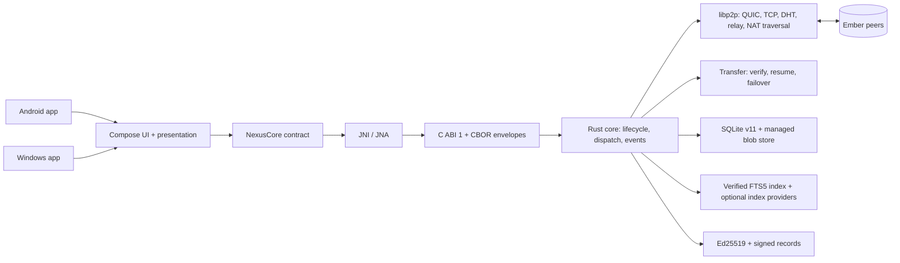

<p align="center">
  
</p>

<h1 align="center">Ember</h1>

<p align="center"><strong>Local-first file sharing. Direct from people, not a central service.</strong></p>

<p align="center">Android · Windows · Kotlin Multiplatform · Compose · Rust · libp2p</p>

<p align="center">
  <a href="https://github.com/farokh-ra/Ember/actions/workflows/ci.yml"></a>
  
  
  
  
  
  
</p>

<p align="center">
  <a href="#overview">Overview</a> ·
  <a href="#capabilities">Capabilities</a> ·
  <a href="#architecture">Architecture</a> ·
  <a href="#status">Status</a> ·
  <a href="#roadmap">Roadmap</a> ·
  <a href="#quick-start">Quick start</a> ·
  <a href="#documentation">Documentation</a>
</p>

> [!IMPORTANT]
> **Ember is proprietary software, not open source.** The repository is publicly
> viewable, but public visibility grants no right to copy, modify, distribute,
> or reuse the source. See [LICENSE.md](LICENSE.md).
>
> **Stage 20 is merged into `feat/19-release`** as merge commit `4f38a8a` (PR
> #27). The launch-readiness follow-up is PR #28, stacked on `feat/19-release`.
> **Stage 19 is merged into `main`** as `2c2b7cf` (PR #26). **Stage 18 is merged
> into `main`** as `8876350`, and **Stages 16 and 17 are merged** through PR #24.
>
> Stage 20 does not mean Ember has launched. Production signing, Android runtime
> evidence, independent-client interoperability, public infrastructure, and
> project-owner launch approval are still missing. See
> [Known Limitations](docs/release/KNOWN_LIMITATIONS.md).

## Overview

Ember is a local-first file sharing application for Android and Windows. A
shared Kotlin Multiplatform and Compose interface sits over a shared Rust core
built on libp2p. Files are published from a user's own device, discovered through
signed records, transferred directly between peers, and verified end to end.

There is no mandatory account, central file host, or company-operated content
service. Devices are the network. Bootstrap peers and relays are optional
infrastructure, not a backend the product depends on.

The design targets a global network, not a two-device utility. Users choose what
to publish and what to host. Replication is never automatic. Attribution stays
cryptographically bound to the original publisher, and removing a replica never
rewrites the original signed record.

### At a glance

| Property | Detail |
|---|---|
| **Current stage** | 20 repository deliverables complete; public launch blocked |
| **Platforms** | Android 8.0+ (API 28) · Windows 10/11 x64 |
| **UI** | Kotlin 2.4.21 · Compose Multiplatform 1.12.2 |
| **Core** | Rust 1.99.1 · ABI 1 · FFI interface 1.11.0 · 51 callable methods |
| **Protocol** | Protocol v1 · identify `0.1.0-stage-12` · storage schema v11 · `/nexus/file/1` · `/nexus/index/1` |
| **Network** | QUIC v1 · TCP + Noise + Yamux · Kademlia DHT · Relay v2 · DCUtR · AutoNAT |
| **Transfer** | 1 MiB verified chunks · up to 4 sources · durable per-chunk resume |
| **Storage** | Content-addressed managed store · quota, reserve, and reference-counted cleanup |
| **License** | Proprietary · all rights reserved |

## Principles

| Principle | What it means |
|---|---|
| **Local-first** | Files live on users' devices. There is no required cloud account or company storage tier. |
| **Explicit by default** | Publishing and hosting are separate user actions. Downloading a file never creates a hosting obligation. |
| **Public by design** | Published files are public. Ember does not offer private-file sharing or private groups. |
| **Verifiable** | Content IDs, chunk manifests, signed records, and publications are checked before data is trusted, cached, or advertised. |
| **Attribution preserved** | A replica is still the original uploader's file. Hosting never transfers authorship. |
| **Bounded and honest** | Quotas, rate limits, record TTLs, timeouts, and failure states are explicit. The UI does not promise availability the core cannot prove. |
| **Two first-class platforms** | Android and Windows run the same product logic and the same Rust core. Neither is a reduced web wrapper. |

## Capabilities

| Area | Delivered through Stage 19 |
|---|---|
| **Identity** | Local Ed25519 identities, stable Bech32m `nx1...` IDs, encrypted key storage, and passphrase-encrypted backups. |
| **Signed records** | Canonical CBOR, exact-byte envelopes, profile and publication v1, revisions, and signed tombstones. |
| **Storage** | SQLite schema v11, atomic managed imports, per-chunk download state, 10 GiB default quota, 1 GiB reserve, 4 GiB file cap, crash reconciliation, corrupt-file quarantine, and local moderation tables. |
| **Discovery** | Kademlia DHT, signed provider records, 24 h record TTL, persisted bootstrap peers, and bounded reconnection. |
| **Connectivity** | QUIC v1, TCP + Noise + Yamux, authenticated direct connections, Circuit Relay v2 fallback, DCUtR hole punching, and AutoNAT reachability. |
| **Transfer** | `/nexus/file/1`, every chunk verified before writing, up to four concurrent sources, observed-reliability scheduling, corrupt-source quarantine, per-chunk resume, and failover when a source disappears. |
| **Profiles** | Signed public profiles, DHT publish and lookup, stale-cache labels, conflict retention, and non-unique usernames treated as labels. |
| **Publishing** | Signed metadata, file pages, DHT announcement, provider serving, unpublish tombstones, and separate signature, serving, and availability states. |
| **Hosting** | Explicit `replica.add`, full verification before advertisement, pause/resume/remove, storage and upload limits, metered and battery gates, and seven-day re-verification. |
| **Search** | Verified local FTS5 index, bounded query language, Explore modes, generation-bound pagination, signed index providers over `/nexus/index/1`, coverage labels, and conflict/duplicate handling. |
| **Native boundary** | C ABI 1, JNI and JNA adapters, versioned CBOR envelopes, event queue, cancellation, and streaming import/export. |
| **Security and abuse** | Local peer blocking, local abuse reports, blocked-peer enforcement across dial, connection, request, discovery, provider, and download sources, bounded moderation tables, and six `security.*` methods. |
| **File safety** | Advisory type classification, visible warnings, `auto_execute: false`, and previews delegated to platform viewers or sandboxes. |
| **Release engineering** | Per-user Windows MSI, portable ZIP, signed Android APK/AAB pipeline, SHA-256 checksums, release manifest, WiX bootstrap, and performance measurement. |
| **Supply chain** | Committed Gradle locks and verification metadata, a deterministic CycloneDX SBOM, and a generated third-party notice bundle. |
| **Quality** | 380 Rust tests, shared Kotlin JVM tests, a C harness, Windows JNA and JNI proxy checks, seven CI jobs, dependency review, and a release workflow. |

## Status

| Area | State |
|---|---|
| Core foundations through Stage 18 | Complete on Windows loopback; Stage 18 merged |
| Stage 19 release engineering | Merged as `2c2b7cf`; test-signed, with Android runtime and production signing pending |
| Stage 20 launch and governance | Repository deliverables complete; public launch blocked |
| Android and Windows applications | Shared clickable UI prototype with visibly labelled demo data |
| Windows networking, transfer, profiles, publishing, hosting, search | Verified on Windows loopback |
| Android runtime networking, hosting, search, and security | Libraries cross-build; on-device evidence deferred |
| Local and distributed search | Complete; provider role is opt-in |
| Multi-peer transfer | Complete on `feat/17-multi-peer`; up to four sources per download |
| Local blocking, abuse reports, and safe-file notices | Complete at the core and network layers; UI binding pending |
| Windows installer and signed release pipeline | Per-user MSI, portable ZIP, APK/AAB, checksums, manifest, SBOM, and notices; test-signed only |
| Launch-readiness supply chain | Gradle locks and verification metadata committed; SBOM and notices generated; public-release review pending |

### Honest limits

- The Kotlin screens still use demo data and are not wired to the Rust core for
  networking, publishing, hosting, or search flows. Explore and Search show
  honest coverage, partial, pagination, and offline labels over sample records.
- Android JNI execution, on-device networking, transfer, profile, publishing,
  replication, and search are not exercised locally. The Android libraries
  compile and export-check; the JNI shim is tested through a Windows-hosted JVM
  proxy.
- Global-network behavior is not claimed yet. Current integration evidence is
  Windows loopback with configurable bootstrap and relay infrastructure.
- No independent client, bootstrap operator, relay operator, or index provider
  has been tested. The public conformance suite is self-conformance for the
  reference implementation, not proof of interoperability.
- No public infrastructure directory is published. The directory and health
  measurement documents are policies, not evidence that community capacity
  exists.
- Stage 20 governance, disclosure, moderation, and maintenance documents are
  proposals awaiting project-owner approval. They do not make Ember launched,
  supported, or production-ready.
- Distributed search coverage is inherently partial. Index providers are
  optional peers, not authorities, and search never claims complete network
  coverage.
- Multi-peer speedup is measured as a deterministic scheduler simulation, not a
  realistic-network benchmark. Android runtime multi-peer transfer and resume
  are deferred.
- Local blocking and reporting are enforced by the core and network layers but
  are not yet rendered in the Kotlin UI. The UI still needs to show the safety
  map and the standing notices.
- Blocking is local. It does not remove content from the network, and a blocked
  peer can return under a new identity.
- File safety classification is extension-based and advisory, not malware
  detection. Previews are delegated; Ember never executes a downloaded file.
- No independent security review has been commissioned. The threat model and
  privacy review record this as a pre-release gap.
- The Windows installer is a per-user MSI, not an Inno Setup EXE. It installs
  under `%LOCALAPPDATA%\Ember` without elevation and supports upgrades through a
  stable UUID. It does not yet offer an uninstall keep/remove choice for user
  data; the packaged UI stores no core data, so this must be added before core
  data is wired in.
- Release artifacts were test-signed with an ephemeral Android key and a
  self-signed Windows certificate. Production signing material was not available,
  so the artifacts are verifiable but not publicly trusted.
- Android runtime, low-memory device, battery, poor-network, mobile, and IPv6
  evidence is still missing.
- Gradle dependency locking and SHA-256 verification metadata are committed, and
  the release script emits a CycloneDX SBOM and a third-party notice bundle.
  CI verifies the metadata on Windows and Linux for its task set; the Linux
  Android release variants remain unexercised. Reproducibility is claimed for
  inputs and checksums, not bit-identical output.
- The notice bundle is generated best-effort from local archives. Some build-only
  components ship no licence file; a public release still needs a reviewed bundle
  with no unexplained component.
- No public release has exercised the supply-chain artifacts, and no lawyer has
  reviewed the notice bundle.

## Architecture

Ember keeps product logic in one Rust core and keeps platform code thin. Android
and Windows share the Compose UI, the `NexusCore` contract, and the same C ABI.
JNI and JNA are adapters over that ABI, not separate implementations.



### Design boundaries

- **Rust owns** identity, cryptography, record validation, storage, networking,
  transfer, publishing, hosting, and search indexing.
- **Kotlin owns** presentation, navigation, state reduction, and platform
  integration. No platform-specific method is added to the C ABI.
- **The ABI is versioned.** ABI 1 carries CBOR envelopes, opaque handles,
  bounded streaming, cancellation, and a coalescing event queue.
- **Records are immutable.** Signed bytes are preserved exactly, verified before
  caching or serving, and never rewritten by replica operations.
- **No central backend.** Bootstrap nodes and relays are optional; the protocol
  does not require a company-operated service.

### Repository map

| Path | Purpose |
|---|---|
| `apps/androidApp` | Android shell, activity, and platform packaging. |
| `apps/desktopApp` | Windows Compose Desktop shell and `jpackage` image. |
| `shared/model` | Serializable DTOs, IDs, events, and redaction helpers. |
| `shared/core-api` | Platform-independent `NexusCore` contract and fake core. |
| `shared/core-client` | JNI/JNA bridge, CBOR codec, event pump, and typed client. |
| `shared/presentation` | View models, state reduction, and screen models. |
| `shared/ui` | Shared Compose screens, components, icons, and theme. |
| `crates/nexus-*` | Twelve Rust crates for the core, protocol, storage, networking, search, FFI, and tests. |
| `docs` | Architecture, decisions, operations, setup, and stage evidence. |
| `docs/assets` | README banner and application icon. |
| `scripts` | Portable setup, build, hygiene, and clean-checkout verification. |
| `.github` | CI, dependency review, Dependabot, and contribution templates. |

<details>
<summary><strong>Rust crate map</strong></summary>

| Crate | Responsibility |
|---|---|
| `nexus-types` | Shared identifiers, limits, and value types. |
| `nexus-crypto` | Cryptographic primitives and canonical encoding. |
| `nexus-protocol` | Signed record schemas and wire validation. |
| `nexus-identity` | Identity lifecycle and encrypted key storage. |
| `nexus-store` | SQLite metadata and managed blob storage. |
| `nexus-transfer` | Streaming import, download, and verification. |
| `nexus-net` | libp2p transports, authenticated peers, DHT, relay, and diagnostics. |
| `nexus-search` | Local full-text search and coverage metadata. |
| `nexus-core` | Lifecycle orchestration, dispatch, and command/event bus. |
| `nexus-ffi` | C ABI surface for the core. |
| `nexus-observability` | Redacted structured logging and diagnostics. |
| `nexus-testkit` | Deterministic harnesses and fixtures. |

</details>

## Roadmap

Stage 20 repository deliverables are complete and merged into `feat/19-release`
as PR #27; the launch-readiness follow-up is PR #28 against `feat/19-release`.
Stage 19 is merged into `main` as `2c2b7cf` (PR #26). Stage 18 is merged into
`main` as `8876350`. Stages 16 and 17 are merged through PR #24, and Stage 15 is
merged into `main`.

| # | Stage | Status |
|---|---|---|
| 01 | Product definition and requirements | Complete |
| 02 | Architecture and technical decision records | Complete |
| 03 | Repository, build system, and developer workflow | Complete |
| 04 | UI foundation and design system | Complete |
| 05 | Local database and file-store foundation | Complete |
| 06 | Identity and cryptographic foundations | Complete |
| 07 | Publishing, chunk manifests, revisions, and tombstones | Complete |
| 08 | C ABI, JNI/JNA adapters, lifecycle, and streaming | Complete; Android runtime deferred |
| 09 | Peer identity, transports, and direct connections | Complete on Windows loopback |
| 10 | Bootstrap, DHT, and decentralized peer discovery | Complete on Windows loopback |
| 11 | NAT traversal, relays, and difficult networks | Complete on Windows loopback |
| 12 | Direct file transfer | Complete on Windows loopback |
| 13 | Profiles and signed public metadata | Complete on Windows loopback |
| 14 | Publishing and file pages | Complete on Windows loopback |
| 15 | Voluntary replication and availability | Complete and merged |
| 16 | Local and distributed search | Complete and merged |
| 17 | Multi-peer downloads and advanced resilience | Complete and merged |
| 18 | Threat model, abuse tests, dependency and protocol hardening | Complete on Windows loopback; merged |
| 19 | Signed releases, installers, performance, parity, and release evidence | Complete and test-signed; merged as `2c2b7cf`; Android runtime and production signing pending |
| 20 | Global launch and network governance | Repository deliverables complete; public launch blocked |

**Stage 19 scope:** per-user Windows MSI and portable package, signed Android
APK/AAB pipeline, checksums and release manifest, performance and compatibility
reports, release notes, update/rollback policy, and accessibility/localization
review. Production signing keys and Android devices were unavailable, so the
stage records test-signing and build-only Android evidence rather than claiming a
public release.

**Stage 20 scope:** public protocol specification, versioning and deprecation
policy, interoperability and self-conformance suite, bootstrap and relay
directory policy, privacy-preserving health design, governance and moderation
principles, security disclosure process, known limitations, and post-launch
maintenance plan. The stage does not publish a release or create public
infrastructure. Production signing, Android runtime evidence, independent
interoperability, and owner approval remain launch blockers.

**Launch-readiness follow-up (PR #28):** Gradle dependency locking, SHA-256
verification metadata, a CycloneDX SBOM, a third-party notice bundle, and the
repository community files (code of conduct, support, governance front door,
code owners, and a release-readiness issue form) are now in place. This closes
the repository-side supply-chain gap only. It does not create a release, and it
does not satisfy the signing, device, independent-interoperability, or
owner-approval gates.

**Stage 18 scope:** local blocking and abuse reports with bounded storage,
enforcement at dial, connection, request, discovery, provider, and download
source layers, advisory safe-file warnings, delegated previews, malformed-input
tests, a threat model, a privacy review, and a security release checklist.
Downloaded content is never executed.

Android runtime evidence for Stages 08-18 remains deferred. Those gaps do not
change the completed Windows-loopback evidence for Stage 18.

## Quick start

### Prerequisites

- Windows 10 or 11 x64.
- PowerShell 5.1 or later.
- Git 2.56 or later.
- Android SDK command-line tools with accepted licenses at
  `%LOCALAPPDATA%\Android\Sdk`.

### Build from a fresh clone

```powershell
Set-ExecutionPolicy -Scope Process -ExecutionPolicy Bypass
.\scripts\setup-windows.ps1
. .\scripts\dev-env.ps1
.\scripts\build.ps1
```

`setup-windows.ps1` installs the pinned portable toolchain under
`%LOCALAPPDATA%\NEXUS\toolchain`. It does not require administrator rights and
does not modify machine-wide environment variables. `dev-env.ps1` configures
only the current PowerShell process.

### Direct commands

```powershell
# Formatting, static analysis, native build, Android, desktop, and shared tests
.\scripts\build.ps1

# Native artifacts, export checks, and the C harness only
.\scripts\build-native.ps1 -Target All -Configuration Release

# Individual Gradle checks
.\gradlew.bat spotlessCheck detekt
.\gradlew.bat :apps:androidApp:assembleDebug
.\gradlew.bat :apps:desktopApp:createDistributable
.\gradlew.bat :shared:model:jvmTest :shared:core-api:jvmTest `
    :shared:core-client:jvmTest :shared:presentation:jvmTest :shared:ui:jvmTest

# Rust checks
cargo fmt --all -- --check
cargo clippy --workspace --all-targets -- -D warnings
cargo test --workspace
cargo deny check
cargo audit

# Regenerate Gradle locks and verification metadata after a dependency change
.\scripts\update-dependency-locks.ps1

# Generate the CycloneDX SBOM and the third-party notice bundle
python .\scripts\generate_sbom.py --version 0.1.0 `
    --sbom .\dist\sbom\ember-0.1.0.cdx.json `
    --notices-dir .\dist\notices

# Release packaging, verification, and performance
.\scripts\fetch-wix.ps1
.\scripts\package-release.ps1 -Version 0.1.0 -AllowDirty -AllowUnsigned
.\scripts\verify-release.ps1 -Directory .\dist\0.1.0
.\scripts\measure-performance.ps1 -Runs 3 -SoakSeconds 180
```

Signing is required for a real release. See
[docs/release/SIGNING_AND_REPRODUCIBILITY.md](docs/release/SIGNING_AND_REPRODUCIBILITY.md).

### Build artifacts

| Artifact | Path |
|---|---|
| Android debug APK | `apps/androidApp/build/outputs/apk/debug/androidApp-debug.apk` |
| Android release APK/AAB | `apps/androidApp/build/outputs/apk/release/` and `.../bundle/release/` |
| Windows application image | `apps/desktopApp/build/compose/binaries/main/app/Ember` |
| Windows per-user MSI | `apps/desktopApp/build/compose/binaries/main/msi/Ember-<version>.msi` |
| Release directory | `dist/<version>/` with APK, AAB, MSI, portable ZIP, CycloneDX SBOM, third-party notices, `SHA256SUMS`, and `release-manifest.json` |
| Generated SBOM | `dist/sbom/ember-<version>.cdx.json` |
| Windows native core | `build/native/windows-x64/nexus_core.dll` |
| Android native cores | `build/native/android-arm64-v8a/libnexus_core.so` and `build/native/android-x86_64/libnexus_core.so` |

The Windows MSI installs per user under `%LOCALAPPDATA%\Ember`; the portable ZIP
runs from any extracted directory. The native core is packaged under
`app/resources`, which the JNA loader checks through
`compose.application.resources.dir`.

### Pinned toolchain

| Tool | Pin |
|---|---|
| JDK | Eclipse Temurin 21.0.13+9 |
| Gradle | 9.9.2 (wrapper committed) |
| Kotlin | 2.4.21 |
| Compose Multiplatform | 1.12.2 |
| Compose Material3 | 1.9.0 |
| Android Gradle Plugin | 9.5.2 |
| Android compile and target SDK | 37 |
| Android minimum SDK | 28 |
| Android build tools | 36.0.0 |
| Android NDK | 29.0.14206865 |
| Rust | 1.99.1, edition 2024 |
| Windows Rust host | `x86_64-pc-windows-msvc` in CI and release; `x86_64-pc-windows-gnu` fallback locally |
| WiX | 3.14.1.8722 (MSI packaging, downloaded with a pinned SHA-256) |

Version pins live in `gradle/libs.versions.toml`, `rust-toolchain.toml`, and
`Cargo.toml`. Do not change a pin without updating
[DEPENDENCY_LICENSE_INVENTORY.md](docs/architecture/DEPENDENCY_LICENSE_INVENTORY.md).

## Quality gates

Every change must pass the same gates locally and in CI:

| Gate | Checks |
|---|---|
| Repository hygiene | Secret scan and forbidden-path check. |
| Kotlin | Spotless, detekt, shared JVM tests, and adapter contract tests. |
| Rust | Formatting, Clippy with warnings denied, and the full workspace test suite. |
| Dependency policy | `cargo deny check`, `cargo audit`, committed Gradle locks, and SHA-256 verification metadata. |
| Supply chain | CycloneDX SBOM generation and validation; generated notice bundle at release time. |
| Packaging | Android debug assembly, Windows application image, and the signed release pipeline. |
| Pull request | Conventional Commit title and dependency review. |

The CI workflow lives in [`.github/workflows/ci.yml`](.github/workflows/ci.yml).
See [docs/DEVELOPMENT_WORKFLOW.md](docs/DEVELOPMENT_WORKFLOW.md) for branches,
commits, reviews, and releases.

## Documentation

| Document | Contents |
|---|---|
| [docs/PRODUCT_REQUIREMENTS.md](docs/PRODUCT_REQUIREMENTS.md) | Product scope and v1 requirements. |
| [docs/ARCHITECTURE.md](docs/ARCHITECTURE.md) | System, module, crate, storage, security, and lifecycle design. |
| [docs/architecture/FFI_INTERFACE.md](docs/architecture/FFI_INTERFACE.md) | C ABI, JNI/JNA mapping, envelopes, events, streaming, and compatibility. |
| [docs/architecture/SIGNED_RECORD_FORMATS.md](docs/architecture/SIGNED_RECORD_FORMATS.md) | Identity, CBOR, signed-record, manifest, tombstone, at-rest, and backup formats. |
| [docs/architecture/DHT_DESIGN.md](docs/architecture/DHT_DESIGN.md) | Kademlia roles, DHT keys, record validation, bounds, and failure behavior. |
| [docs/architecture/NAT_TRAVERSAL.md](docs/architecture/NAT_TRAVERSAL.md) | Relay fallback, hole punching, NAT status, path reporting, and bounds. |
| [docs/architecture/FILE_TRANSFER.md](docs/architecture/FILE_TRANSFER.md) | `/nexus/file/1`, chunk verification, resume, failover, and limits. |
| [docs/progress/STAGE_16.md](docs/progress/STAGE_16.md) | Stage 16 scope, architecture, tests, and verification evidence. |
| [docs/progress/STAGE_17.md](docs/progress/STAGE_17.md) | Stage 17 multi-peer scheduling, resilience, schema, tests, and verification evidence. |
| [docs/progress/STAGE_18.md](docs/progress/STAGE_18.md) | Stage 18 threat model, blocking, abuse reports, safe files, tests, and verification evidence. |
| [docs/progress/STAGE_19.md](docs/progress/STAGE_19.md) | Stage 19 release pipeline, artifacts, performance, compatibility, and exit evidence. |
| [docs/progress/STAGE_20.md](docs/progress/STAGE_20.md) | Stage 20 protocol, conformance, governance, policy, and launch-gate evidence. |
| [docs/protocol/PROTOCOL_SPEC.md](docs/protocol/PROTOCOL_SPEC.md) | Public protocol v1 specification, vectors, wire messages, limits, and security properties. |
| [docs/protocol/INTEROPERABILITY.md](docs/protocol/INTEROPERABILITY.md) | Self-conformance coverage, independent-client gaps, and reporting process. |
| [docs/governance/GOVERNANCE.md](docs/governance/GOVERNANCE.md) | Decision classes, maintainer roles, release authority, and conflicts of interest. |
| [docs/governance/MODERATION_PRINCIPLES.md](docs/governance/MODERATION_PRINCIPLES.md) | Local-first safety, operator autonomy, abuse handling, and transparency. |
| [docs/operations](docs/operations/INFRASTRUCTURE_DIRECTORY.md) | Bootstrap, relay, directory, and network-health operations policy. |
| [docs/release](docs/release/README.md) | Performance, compatibility, signing, reproducibility, update/rollback, release notes, accessibility, known limitations, SBOM, notices, and maintenance. |
| [docs/release/SBOM_AND_NOTICES.md](docs/release/SBOM_AND_NOTICES.md) | Gradle locks, verification metadata, CycloneDX SBOM, notice bundle, and remaining limits. |
| [THIRD_PARTY_NOTICES.md](THIRD_PARTY_NOTICES.md) | Committed third-party notice summary packaged with the Windows application. |
| [CODE_OF_CONDUCT.md](CODE_OF_CONDUCT.md) | Contributor Covenant standards and the private enforcement contact. |
| [SUPPORT.md](SUPPORT.md) | Supported builds, issue channels, response expectations, and unsupported areas. |
| [GOVERNANCE.md](GOVERNANCE.md) | Current owner-led decision model and the path to the proposed process. |
| [docs/security/THREAT_MODEL.md](docs/security/THREAT_MODEL.md) | Assets, boundaries, threats, controls, residual risks, and non-goals. |
| [docs/security/PRIVACY_REVIEW.md](docs/security/PRIVACY_REVIEW.md) | Data inventory, public and local data, telemetry, retention, and findings. |
| [docs/security/SECURITY_RELEASE_CHECKLIST.md](docs/security/SECURITY_RELEASE_CHECKLIST.md) | Release gate for versions, analysis, keys, protocol, abuse, files, privacy, storage, and supply chain. |
| [docs/HANDOFF.md](docs/HANDOFF.md) | Current project state, decisions, and exact next action. |
| [docs/decisions](docs/decisions/README.md) | Accepted architecture decision records. |
| [docs/DEVELOPER_SETUP.md](docs/DEVELOPER_SETUP.md) | Repeatable Windows setup and troubleshooting. |
| [docs/DEVELOPMENT_WORKFLOW.md](docs/DEVELOPMENT_WORKFLOW.md) | Branches, commits, pull requests, releases, and CI. |
| [docs/LOGGING_POLICY.md](docs/LOGGING_POLICY.md) | Secret-safe debug logging and redaction rules. |
| [CONTRIBUTING.md](CONTRIBUTING.md) | Development workflow and definition of done. |
| [CHANGELOG.md](CHANGELOG.md) | User-visible changes. |

### Brand assets

| Asset | Size | Use |
|---|---|---|
| [Ember application icon](docs/assets/ember-icon.png) | 1024x1024 | Application identity |
| [Ember README banner](docs/assets/ember-banner.png) | 1600x500 | Repository hero image |

## Security

Do not commit API keys, private keys, keystores, signing certificates, recovery
phrases, or personal data. Report vulnerabilities privately as described in
[SECURITY.md](SECURITY.md); do not open a public issue with exploit details.
Debug logs must be redacted according to
[docs/LOGGING_POLICY.md](docs/LOGGING_POLICY.md).

Stages 18 and 20 document the current threat model, privacy review, disclosure
process, and release gate in [docs/security](docs/security/THREAT_MODEL.md).
Local blocking and abuse reports stay on the device. Downloaded files are never
executed, and previews are delegated to platform handlers or a sandbox. No
telemetry or automatic crash reporting is enabled.

## License

Ember is proprietary software. See [LICENSE.md](LICENSE.md). Public visibility
is not permission: no right is granted to copy, modify, distribute, or reuse the
source except as expressly permitted by the license or mandatory applicable law.

<div align="center">
  <br />
  <sub><strong>Ember</strong> · local-first by design · direct by default</sub><br />
  <sub>Copyright © 2026 farokh-ra. All rights reserved.</sub>
</div>
