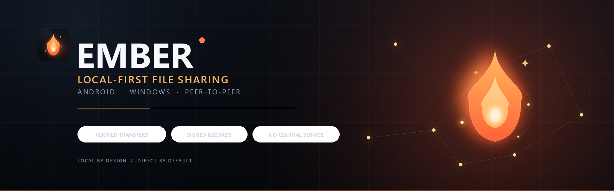
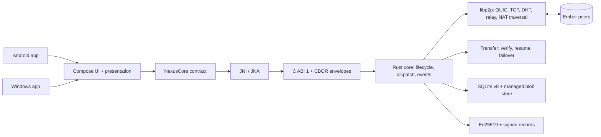

<p align="center">
  
</p>

<h1 align="center">Ember</h1>

<p align="center"><strong>Local-first file sharing. Direct from people, not a central service.</strong></p>

<p align="center">Android · Windows · Kotlin Multiplatform · Compose · Rust · libp2p</p>

<p align="center">
  <a href="https://github.com/farokh-ra/Ember/actions/workflows/ci.yml"></a>
  
  
  
  
  
  
  
</p>

<p align="center">
  <a href="#overview">Overview</a> ·
  <a href="#capabilities">Capabilities</a> ·
  <a href="#architecture">Architecture</a> ·
  <a href="#status">Status</a> ·
  <a href="#roadmap">Roadmap</a> ·
  <a href="#quick-start">Quick start</a> ·
  <a href="#documentation">Documentation</a>
</p>

> [!IMPORTANT]
> **Ember is proprietary software, not open source.** The repository is publicly
> viewable, but public visibility grants no right to copy, modify, distribute,
> or reuse the source. See [LICENSE.md](LICENSE.md).
>
> **Stage 15 is complete and merged** into `main` as `264dcbb` through PR #18.
> **Stage 16 — local and distributed search — has not started** and requires
> explicit project-owner approval.

## Overview

Ember is a local-first file sharing application for Android and Windows. A
shared Kotlin Multiplatform and Compose interface sits over a shared Rust core
built on libp2p. Files are published from a user's own device, discovered through
signed records, transferred directly between peers, and verified end to end.

There is no mandatory account, central file host, or company-operated content
service. Devices are the network. Bootstrap peers and relays are optional
infrastructure, not a backend the product depends on.

The design targets a global network, not a two-device utility. Users choose what
to publish and what to host. Replication is never automatic. Attribution stays
cryptographically bound to the original publisher, and removing a replica never
rewrites the original signed record.

### At a glance

| Property | Detail |
|---|---|
| **Current stage** | 15 complete and merged · 16 next, not started |
| **Platforms** | Android 8.0+ (API 28) · Windows 10/11 x64 |
| **UI** | Kotlin 2.4.21 · Compose Multiplatform 1.12.2 |
| **Core** | Rust 1.99.1 · ABI 1 · FFI interface 1.8.0 · 42 callable methods |
| **Protocol** | `0.1.0-stage-15` · schema v8 · `/nexus/file/1` |
| **Network** | QUIC v1 · TCP + Noise + Yamux · Kademlia DHT · Relay v2 · DCUtR · AutoNAT |
| **Transfer** | 1 MiB verified chunks · durable resume · source failover |
| **Storage** | Content-addressed managed store · quota, reserve, and reference-counted cleanup |
| **License** | Proprietary · all rights reserved |

## Principles

| Principle | What it means |
|---|---|
| **Local-first** | Files live on users' devices. There is no required cloud account or company storage tier. |
| **Explicit by default** | Publishing and hosting are separate user actions. Downloading a file never creates a hosting obligation. |
| **Public by design** | Published files are public. Ember does not offer private-file sharing or private groups. |
| **Verifiable** | Content IDs, chunk manifests, signed records, and publications are checked before data is trusted, cached, or advertised. |
| **Attribution preserved** | A replica is still the original uploader's file. Hosting never transfers authorship. |
| **Bounded and honest** | Quotas, rate limits, record TTLs, timeouts, and failure states are explicit. The UI does not promise availability the core cannot prove. |
| **Two first-class platforms** | Android and Windows run the same product logic and the same Rust core. Neither is a reduced web wrapper. |

## Capabilities

| Area | Delivered through Stage 15 |
|---|---|
| **Identity** | Local Ed25519 identities, stable Bech32m `nx1...` IDs, encrypted key storage, and passphrase-encrypted backups. |
| **Signed records** | Canonical CBOR, exact-byte envelopes, profile and publication v1, revisions, and signed tombstones. |
| **Storage** | SQLite schema v8, atomic managed imports, 10 GiB default quota, 1 GiB reserve, 4 GiB file cap, crash reconciliation, and corrupt-file quarantine. |
| **Discovery** | Kademlia DHT, signed provider records, 24 h record TTL, persisted bootstrap peers, and bounded reconnection. |
| **Connectivity** | QUIC v1, TCP + Noise + Yamux, authenticated direct connections, Circuit Relay v2 fallback, DCUtR hole punching, and AutoNAT reachability. |
| **Transfer** | `/nexus/file/1`, every chunk verified before writing, pause/resume, process-death recovery, and failover to another connected source. |
| **Profiles** | Signed public profiles, DHT publish and lookup, stale-cache labels, conflict retention, and non-unique usernames treated as labels. |
| **Publishing** | Signed metadata, file pages, DHT announcement, provider serving, unpublish tombstones, and separate signature, serving, and availability states. |
| **Hosting** | Explicit `replica.add`, full verification before advertisement, pause/resume/remove, storage and upload limits, metered and battery gates, and seven-day re-verification. |
| **Native boundary** | C ABI 1, JNI and JNA adapters, versioned CBOR envelopes, event queue, cancellation, and streaming import/export. |
| **Quality** | 286 Rust tests, shared Kotlin JVM tests, a C harness, Windows JNA and JNI proxy checks, and seven CI jobs. |

## Status

| Area | State |
|---|---|
| Core foundations through Stage 15 | Complete and merged |
| Android and Windows applications | Shared clickable UI prototype with visibly labelled demo data |
| Windows networking, transfer, profiles, publishing, hosting | Verified on Windows loopback |
| Android runtime networking and hosting | Libraries cross-build; on-device evidence deferred |
| Local and distributed search | Stage 16; not started |
| Windows installer and signed releases | Stage 19; the current Windows build is an app image |

### Honest limits

- The Kotlin screens still use demo data and are not wired to the Rust core for
  networking, publishing, hosting, or search flows.
- Android JNI execution, on-device networking, transfer, profile, publishing,
  and replication are not exercised locally. The Android libraries compile and
  export-check; the JNI shim is tested through a Windows-hosted JVM proxy.
- Global-network behavior is not claimed yet. Current integration evidence is
  Windows loopback with configurable bootstrap and relay infrastructure.
- Search is schema-only in the current database; Stage 16 populates and queries
  it.
- The Windows build is an application image, not an installer. Inno Setup
  packaging is Stage 19.

## Architecture

Ember keeps product logic in one Rust core and keeps platform code thin. Android
and Windows share the Compose UI, the `NexusCore` contract, and the same C ABI.
JNI and JNA are adapters over that ABI, not separate implementations.



### Design boundaries

- **Rust owns** identity, cryptography, record validation, storage, networking,
  transfer, publishing, hosting, and search indexing.
- **Kotlin owns** presentation, navigation, state reduction, and platform
  integration. No platform-specific method is added to the C ABI.
- **The ABI is versioned.** ABI 1 carries CBOR envelopes, opaque handles,
  bounded streaming, cancellation, and a coalescing event queue.
- **Records are immutable.** Signed bytes are preserved exactly, verified before
  caching or serving, and never rewritten by replica operations.
- **No central backend.** Bootstrap nodes and relays are optional; the protocol
  does not require a company-operated service.

### Repository map

| Path | Purpose |
|---|---|
| `apps/androidApp` | Android shell, activity, and platform packaging. |
| `apps/desktopApp` | Windows Compose Desktop shell and `jpackage` image. |
| `shared/model` | Serializable DTOs, IDs, events, and redaction helpers. |
| `shared/core-api` | Platform-independent `NexusCore` contract and fake core. |
| `shared/core-client` | JNI/JNA bridge, CBOR codec, event pump, and typed client. |
| `shared/presentation` | View models, state reduction, and screen models. |
| `shared/ui` | Shared Compose screens, components, icons, and theme. |
| `crates/nexus-*` | Twelve Rust crates for the core, protocol, storage, networking, search, FFI, and tests. |
| `docs` | Architecture, decisions, operations, setup, and stage evidence. |
| `docs/assets` | README banner and application icon. |
| `scripts` | Portable setup, build, hygiene, and clean-checkout verification. |
| `.github` | CI, dependency review, Dependabot, and contribution templates. |

<details>
<summary><strong>Rust crate map</strong></summary>

| Crate | Responsibility |
|---|---|
| `nexus-types` | Shared identifiers, limits, and value types. |
| `nexus-crypto` | Cryptographic primitives and canonical encoding. |
| `nexus-protocol` | Signed record schemas and wire validation. |
| `nexus-identity` | Identity lifecycle and encrypted key storage. |
| `nexus-store` | SQLite metadata and managed blob storage. |
| `nexus-transfer` | Streaming import, download, and verification. |
| `nexus-net` | libp2p transports, authenticated peers, DHT, relay, and diagnostics. |
| `nexus-search` | Local full-text search and coverage metadata. |
| `nexus-core` | Lifecycle orchestration, dispatch, and command/event bus. |
| `nexus-ffi` | C ABI surface for the core. |
| `nexus-observability` | Redacted structured logging and diagnostics. |
| `nexus-testkit` | Deterministic harnesses and fixtures. |

</details>

## Roadmap

Stage 15 is merged. Stage 16 is the next body of work and has not started.

| # | Stage | Status |
|---|---|---|
| 01 | Product definition and requirements | Complete |
| 02 | Architecture and technical decision records | Complete |
| 03 | Repository, build system, and developer workflow | Complete |
| 04 | UI foundation and design system | Complete |
| 05 | Local database and file-store foundation | Complete |
| 06 | Identity and cryptographic foundations | Complete |
| 07 | Publishing, chunk manifests, revisions, and tombstones | Complete |
| 08 | C ABI, JNI/JNA adapters, lifecycle, and streaming | Complete; Android runtime deferred |
| 09 | Peer identity, transports, and direct connections | Complete on Windows loopback |
| 10 | Bootstrap, DHT, and decentralized peer discovery | Complete on Windows loopback |
| 11 | NAT traversal, relays, and difficult networks | Complete on Windows loopback |
| 12 | Direct file transfer | Complete on Windows loopback |
| 13 | Profiles and signed public metadata | Complete on Windows loopback |
| 14 | Publishing and file pages | Complete on Windows loopback |
| 15 | Voluntary replication and availability | Complete and merged |
| 16 | Local and distributed search | **Next; requires approval** |
| 17 | Full UI, accessibility, settings, foreground service, Windows tray | Planned |
| 18 | Threat model, abuse tests, dependency and protocol hardening | Planned |
| 19 | Signed releases, installers, performance, parity, and release evidence | Planned |

**Stage 16 scope:** a verified local FTS5 index, the Explore search experience,
signed index-provider records, coverage labels, pagination, provider-loss
handling, and bounded query deadlines. Invalid or unsigned records must never
enter the index or appear in results.

Android runtime evidence for Stages 08–15 remains deferred. Those gaps do not
change the completed Windows-loopback evidence for Stage 15.

## Quick start

### Prerequisites

- Windows 10 or 11 x64.
- PowerShell 5.1 or later.
- Git 2.56 or later.
- Android SDK command-line tools with accepted licenses at
  `%LOCALAPPDATA%\Android\Sdk`.

### Build from a fresh clone

```powershell
Set-ExecutionPolicy -Scope Process -ExecutionPolicy Bypass
.\scripts\setup-windows.ps1
. .\scripts\dev-env.ps1
.\scripts\build.ps1
```

`setup-windows.ps1` installs the pinned portable toolchain under
`%LOCALAPPDATA%\NEXUS\toolchain`. It does not require administrator rights and
does not modify machine-wide environment variables. `dev-env.ps1` configures
only the current PowerShell process.

### Direct commands

```powershell
# Formatting, static analysis, native build, Android, desktop, and shared tests
.\scripts\build.ps1

# Native artifacts, export checks, and the C harness only
.\scripts\build-native.ps1 -Target All -Configuration Release

# Individual Gradle checks
.\gradlew.bat spotlessCheck detekt
.\gradlew.bat :apps:androidApp:assembleDebug
.\gradlew.bat :apps:desktopApp:createDistributable
.\gradlew.bat :shared:model:jvmTest :shared:core-api:jvmTest `
    :shared:core-client:jvmTest :shared:presentation:jvmTest :shared:ui:jvmTest

# Rust checks
cargo fmt --all -- --check
cargo clippy --workspace --all-targets -- -D warnings
cargo test --workspace
cargo deny check
cargo audit
```

### Build artifacts

| Artifact | Path |
|---|---|
| Android debug APK | `apps/androidApp/build/outputs/apk/debug/androidApp-debug.apk` |
| Windows application image | `apps/desktopApp/build/compose/binaries/main/app/Ember` |
| Windows native core | `build/native/windows-x64/nexus_core.dll` |
| Android native cores | `build/native/android-arm64-v8a/libnexus_core.so` and `build/native/android-x86_64/libnexus_core.so` |

The Windows image is not yet an installer. The Inno Setup per-user installer is
scheduled for Stage 19, as defined by ADR-0009.

### Pinned toolchain

| Tool | Pin |
|---|---|
| JDK | Eclipse Temurin 21.0.13+9 |
| Gradle | 9.9.1 (wrapper committed) |
| Kotlin | 2.4.21 |
| Compose Multiplatform | 1.12.2 |
| Compose Material3 | 1.9.0 |
| Android Gradle Plugin | 9.5.1 |
| Android compile and target SDK | 37 |
| Android minimum SDK | 28 |
| Android build tools | 36.0.0 |
| Android NDK | 29.0.14206865 |
| Rust | 1.99.1, edition 2024 |
| Windows Rust host | `x86_64-pc-windows-msvc` in CI and release; `x86_64-pc-windows-gnu` fallback locally |
| Inno Setup | 6.4.3 (Stage 19 packaging) |

Version pins live in `gradle/libs.versions.toml`, `rust-toolchain.toml`, and
`Cargo.toml`. Do not change a pin without updating
[DEPENDENCY_LICENSE_INVENTORY.md](docs/architecture/DEPENDENCY_LICENSE_INVENTORY.md).

## Quality gates

Every change must pass the same gates locally and in CI:

| Gate | Checks |
|---|---|
| Repository hygiene | Secret scan and forbidden-path check. |
| Kotlin | Spotless, detekt, shared JVM tests, and adapter contract tests. |
| Rust | Formatting, Clippy with warnings denied, and the full workspace test suite. |
| Dependency policy | `cargo deny check` and `cargo audit`. |
| Packaging | Android debug assembly and Windows application image. |
| Pull request | Conventional Commit title and dependency review. |

The CI workflow lives in [`.github/workflows/ci.yml`](.github/workflows/ci.yml).
See [docs/DEVELOPMENT_WORKFLOW.md](docs/DEVELOPMENT_WORKFLOW.md) for branches,
commits, reviews, and releases.

## Documentation

| Document | Contents |
|---|---|
| [docs/PRODUCT_REQUIREMENTS.md](docs/PRODUCT_REQUIREMENTS.md) | Product scope and v1 requirements. |
| [docs/ARCHITECTURE.md](docs/ARCHITECTURE.md) | System, module, crate, storage, security, and lifecycle design. |
| [docs/architecture/FFI_INTERFACE.md](docs/architecture/FFI_INTERFACE.md) | C ABI, JNI/JNA mapping, envelopes, events, streaming, and compatibility. |
| [docs/architecture/SIGNED_RECORD_FORMATS.md](docs/architecture/SIGNED_RECORD_FORMATS.md) | Identity, CBOR, signed-record, manifest, tombstone, at-rest, and backup formats. |
| [docs/architecture/DHT_DESIGN.md](docs/architecture/DHT_DESIGN.md) | Kademlia roles, DHT keys, record validation, bounds, and failure behavior. |
| [docs/architecture/NAT_TRAVERSAL.md](docs/architecture/NAT_TRAVERSAL.md) | Relay fallback, hole punching, NAT status, path reporting, and bounds. |
| [docs/architecture/FILE_TRANSFER.md](docs/architecture/FILE_TRANSFER.md) | `/nexus/file/1`, chunk verification, resume, failover, and limits. |
| [docs/progress/STAGE_15.md](docs/progress/STAGE_15.md) | Stage 15 scope, architecture, tests, and verification evidence. |
| [docs/HANDOFF.md](docs/HANDOFF.md) | Current project state, decisions, and exact next action. |
| [docs/decisions](docs/decisions/README.md) | Accepted architecture decision records. |
| [docs/DEVELOPER_SETUP.md](docs/DEVELOPER_SETUP.md) | Repeatable Windows setup and troubleshooting. |
| [docs/DEVELOPMENT_WORKFLOW.md](docs/DEVELOPMENT_WORKFLOW.md) | Branches, commits, pull requests, releases, and CI. |
| [docs/LOGGING_POLICY.md](docs/LOGGING_POLICY.md) | Secret-safe debug logging and redaction rules. |
| [CONTRIBUTING.md](CONTRIBUTING.md) | Development workflow and definition of done. |
| [CHANGELOG.md](CHANGELOG.md) | User-visible changes. |

### Brand assets

| Asset | Size | Use |
|---|---|---|
| [Ember application icon](docs/assets/ember-icon.png) | 1024x1024 | Application identity |
| [Ember README banner](docs/assets/ember-banner.png) | 1600x500 | Repository hero image |

## Security

Do not commit API keys, private keys, keystores, signing certificates, recovery
phrases, or personal data. Report vulnerabilities privately as described in
[SECURITY.md](SECURITY.md); do not open a public issue with exploit details.
Debug logs must be redacted according to
[docs/LOGGING_POLICY.md](docs/LOGGING_POLICY.md).

## License

Ember is proprietary software. See [LICENSE.md](LICENSE.md). Public visibility
is not permission: no right is granted to copy, modify, distribute, or reuse the
source except as expressly permitted by the license or mandatory applicable law.

<div align="center">
  <br />
  <sub><strong>Ember</strong> · local-first by design · direct by default</sub><br />
  <sub>Copyright © 2026 farokh-ra. All rights reserved.</sub>
</div>
