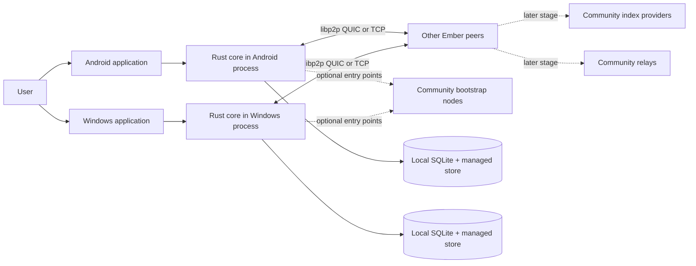

# Ember Architecture

| Field | Value |
|---|---|
| Document ID | NEXUS-ARCH-001 |
| Version | 1.0.0 |
| Status | Accepted for Stage 02 |
| Date | 2026-11-12 |
| Normative product source | [Product requirements](PRODUCT_REQUIREMENTS.md) |
| Decision records | [ADR index](decisions/README.md) |
| Diagrams | [Component diagrams](architecture/COMPONENT_DIAGRAMS.md) |
| FFI contract | [FFI interface draft](architecture/FFI_INTERFACE.md) |
| Dependency policy | [Dependency and license inventory](architecture/DEPENDENCY_LICENSE_INVENTORY.md) |

## 1. Scope and status

This document defines the first-release architecture for Ember: a local-first, peer-to-peer file publishing and discovery application for Android and Windows. It covers the application shells, the shared Kotlin/Compose layer, the Rust core, storage, networking, transfer, replication, search, security boundaries, lifecycle, packaging, and verification strategy.

Stage 02 produced this design commitment. Build and runtime evidence begins in Stage 03 and continues through Stage 19; each realized stage is recorded in `docs/progress`.

The architecture must satisfy three exit criteria:

1. Every major component has one responsibility.
2. Android and Windows use the same Rust core API.
3. No core feature requires a centralized company backend.

The three criteria are addressed in sections 4, 6, and 3 respectively, and are verified at the stages listed in section 18.

## 2. Architectural drivers

### 2.1 Product constraints

| Constraint | Architectural consequence |
|---|---|
| Local-first operation | Identity, profiles, records, downloads, replicas, settings, and search work without a network. Network work is asynchronous and bounded. |
| No central backend | No account, search, storage, relay, or telemetry service is required. Bootstrap and index providers are optional, replaceable peers. |
| Verify before trust | Every signed record, manifest, chunk, and completed file is verified before use or advertisement. |
| Explicit user control | Publishing, replication, quotas, bandwidth, and background activity are user actions. No silent seeding or hidden upload. |
| Android and Windows are first-class | One shared UI and core, with platform-native integration for files, notifications, secure storage, background execution, and installers. |
| 4 GiB files, bounded memory | Streaming import, chunked transfer, flat manifests, bounded buffers, and no file content in CBOR or SQLite. |
| Honest states | UI state is derived from core state. Offline, degraded, partial, stale, and unpublished are distinct states. |
| No remote deletion promise | Unpublish is a signed tombstone; replicas may keep serving with an unpublished warning. |

### 2.2 Quality attributes

| Attribute | Target | Design response |
|---|---|---|
| Startup | Android ≤5 s p95; Windows ≤3 s p95; offline-usable | Open local DB first, start network asynchronously, never block on bootstrap. |
| UI responsiveness | No main-thread block >200 ms | All native calls off the UI thread; async operations and event pump. |
| Memory | Android idle ≤250 MB; Windows ≤300 MB; transfer ≤128 MiB per download | Bounded queues, 1 MiB chunks, streaming hashes, at most two hash jobs. |
| Local query | p95 ≤100 ms at 10,000 records | SQLite WAL, indexed fields, FTS5, bounded page cache. |
| Search | Local first results ≤500 ms; remote partial ≤10 s | Local-first query, bounded fan-out, total deadline, coverage labels. |
| Reliability | Crash-free sessions ≥99.5%; 24-hour session | Durable state machines, WAL recovery, atomic file promotion, cancellation. |
| Battery | No idle wake locks; no unbounded chatter | Event-driven networking, timers with backoff, foreground work only when visible. |
| Security | No plaintext keys; strict verification | Key custody outside SQLite, panics contained at FFI, bounded parsers, redacted logs. |
| Accessibility | WCAG 2.2 AA, TalkBack and Narrator journeys | Shared Compose semantics plus platform accessibility integration. |

## 3. System context

Ember is a peer-to-peer application. There is no Ember-operated account service, file host, search database, or telemetry endpoint. Community bootstrap nodes help peers join the network but are not identity, ownership, or content authorities.



### 3.1 No central backend rule

- The app has no account, login, cloud sync, or central identity recovery.
- The default bootstrap list is compiled into the release and contains at least three independently operated entry points. Losing one does not disable the network.
- Search uses a local index and optional peer index providers. No company-operated search endpoint exists.
- Relay is not part of v1. Later relay support is optional and community-operated.
- No telemetry or crash reporting is enabled by default. Diagnostics are generated locally and exported only by the user.
- Release updates are delivered through platform distribution or a signed installer, not a mandatory runtime service.
- Any future optional service must be replaceable, non-authoritative for identity and ownership, and approved by a new ADR.

## 4. Components and responsibilities

### 4.1 Application containers

| Container | Technology | Responsibility | Lifetime |
|---|---|---|---|
| Android app | Kotlin, Compose Multiplatform, Android SDK | Activity, application lifecycle, foreground service, notifications, Storage Access Framework, Android Keystore, accessibility integration. | Android process |
| Windows app | Kotlin, Compose Multiplatform for Desktop, JVM | Window, tray, file dialogs, DPAPI, notification integration, installer integration. | JVM process |
| Shared UI and presentation | Kotlin Multiplatform common code | Screens, navigation, state, validation, formatting, accessibility semantics, fake core for tests. | App process |
| Core client | Kotlin common + platform actuals | Typed `NexusCore` API, CBOR codec, JNI/JNA bridge, event pump, error mapping. | App process |
| Rust core | Rust, Tokio, libp2p, SQLite | Identity, protocol, storage, networking, transfer, replication, search, diagnostics. | App process |

### 4.2 Kotlin modules

| Module | Single responsibility | Must not |
|---|---|---|
| `shared/model` | Serializable DTOs, IDs, error types, event envelopes, UI-facing value objects. | Perform I/O, hold secret material, or depend on Compose. |
| `shared/core-api` | `NexusCore` interface, operation handles, event flows, fake implementation, contract tests. | Know about JNI, JNA, SQLite, libp2p, or platform APIs. |
| `shared/core-client` | FFI bridge, CBOR envelope codec, event pump, ABI/version check, memory copying. | Render UI or enforce product policy. |
| `shared/presentation` | View models, navigation, state reduction, input validation, formatting, screen models. | Open the database, managed store, or network sockets. |
| `shared/ui` | Compose screens, components, theme, strings, accessibility semantics, responsive layouts. | Call native code directly or make durability decisions. |
| `apps/androidApp` | Android shell and platform integrations. | Duplicate core logic or write durable Ember state. |
| `apps/desktopApp` | Windows shell and platform integrations. | Duplicate core logic or write durable Ember state. |

### 4.3 Rust crates

| Crate | Single responsibility | Must not |
|---|---|---|
| `nexus-types` | Shared IDs, timestamps, size limits, error codes, settings DTOs. | Perform I/O, networking, or persistence. |
| `nexus-crypto` | Ed25519, SHA-256, canonical CBOR, domain-separated signatures, identity IDs, key backup and at-rest encryption. | Own database rows, network policy, or UI decisions. |
| `nexus-protocol` | Publication, profile, tombstone, manifest, and wire schemas; validation; DHT key derivation; version rules. | Store bytes, dial peers, or mutate local state. |
| `nexus-identity` | Identity lifecycle, encrypted key file, LEK handling, restore/export coordination. | Read the network or write publication records directly. |
| `nexus-store` | SQLite schema and migrations, managed blob store, quota, reference counts, metadata export, reconciliation. | Parse network records or make product policy decisions. |
| `nexus-transfer` | Streaming import, chunk manifests, download state machine, verification, export, replica re-verification. | Decide search ranking, publish profile records, or bypass store rules. |
| `nexus-net` | libp2p node, transports, peer identity, DHT, bootstrap, request/response, peer observations, network state. | Interpret signed records as trusted data or write SQLite directly. |
| `nexus-search` | Local FTS index, Explore queries, optional index-provider client, coverage metadata. | Trust unverified records or mutate signed records. |
| `nexus-core` | Lifecycle, orchestration, command/event bus, operation registry, settings, snapshots. | Duplicate crate-specific logic or expose raw internals over FFI. |
| `nexus-ffi` | C ABI, JNI shim, handle registry, buffer ownership, CBOR envelopes, panic containment. | Implement protocol or storage logic. |
| `nexus-observability` | Redacted structured logs, rotation, diagnostics bundle, crash markers. | Record secrets, passphrases, raw keys, or unnecessary local paths. |
| `nexus-testkit` | Test harnesses, fake peers, deterministic clocks, cross-platform vectors. | Ship in release artifacts. |

Dependency direction is acyclic:

```text
nexus-ffi -> nexus-core
nexus-core -> nexus-identity, nexus-net, nexus-transfer, nexus-search,
              nexus-store, nexus-protocol, nexus-observability
nexus-identity -> nexus-crypto, nexus-store, nexus-types
nexus-net -> nexus-protocol, nexus-crypto, nexus-types
nexus-transfer -> nexus-protocol, nexus-store, nexus-crypto, nexus-types
nexus-search -> nexus-store, nexus-protocol, nexus-types
nexus-store -> nexus-types
nexus-protocol -> nexus-crypto, nexus-types
nexus-crypto -> nexus-types
nexus-observability -> nexus-types
```

### 4.4 Responsibility rules

1. `nexus-core` coordinates; it does not reimplement a lower crate's validation.
2. `nexus-net` treats every peer byte as untrusted and hands bounded records to `nexus-protocol`.
3. `nexus-store` is the only crate that opens SQLite or writes the managed store.
4. `nexus-transfer` is the only crate that promotes bytes into a verified content blob.
5. `nexus-search` indexes only records that `nexus-protocol` and `nexus-store` have verified.
6. Kotlin never writes durable Ember state and never parses a signed record as authoritative.
7. Platform shells own platform APIs; shared code depends on narrow interfaces.

## 5. Runtime, process, and threading model

### 5.1 Process model

- One core instance per application process.
- One application process per user session on Windows, enforced by a named single-instance guard.
- Android uses a single application process; no exported core service.
- The core is a native library, not a separate daemon. Stage 11 relay and Stage 10 bootstrap operations may use a separate headless build, but the app does not become an always-on public node.

### 5.2 Threads and pools

| Execution context | Owner | Responsibility | Bounds |
|---|---|---|---|
| UI main thread | Compose | Rendering, input, accessibility. | No native calls, no disk or network I/O. |
| Kotlin IO dispatcher | `shared/core-client` | FFI calls, import/export streaming, file picker handoff. | Bounded by coroutine dispatcher. |
| Event pump thread | `shared/core-client` | Single blocking `next_event` consumer. | Exactly one consumer. |
| Tokio runtime | `nexus-core` | Async I/O, timers, libp2p, request/response. | 2–4 worker threads, configured at core creation. |
| SQLite writer | `nexus-store` | Serialized writes and migrations. | One thread. |
| SQLite readers | `nexus-store` | Queries, snapshots, search reads. | 2 connections. |
| Hashing pool | `nexus-transfer` | Streaming SHA-256, manifest and verification work. | At most 2 concurrent jobs; 1 MiB buffers. |
| Import/export calls | `nexus-ffi` | Bounded chunk writes and reads. | Caller-driven, no whole-file buffering. |

No operation creates an unbounded thread. No callback re-enters the JVM from a Rust thread. Progress and completion are delivered through the event queue.

### 5.3 Core and network states

```text
Core:     Created -> Starting -> Running -> Stopping -> Stopped -> Destroyed
                          \-> Failed

Network:  Disabled -> Starting -> Online -> Degraded -> Unavailable -> Stopping
                          \-> Failed
```

- Core state and network state are separate. A running core can be offline.
- `Online` requires at least one connected peer. `Degraded` means listeners are up but no peer is connected. The UI never infers online state from a cached record.
- Stage 09 realizes the network names `disabled`, `starting`, `online`, `degraded`, `unavailable`, and `stopping`; `failed` remains a terminal start outcome reported through `unavailable` plus `last_error`.
- `stop` pauses transfers, persists verified progress, stops networking, flushes SQLite, and zeroizes keys.
- `start` and `stop` are idempotent; `destroy` releases the handle.

### 5.4 Startup and shutdown sequences

Startup:

1. The platform shell creates `CoreHost` and applies the single-instance guard.
2. The host obtains or creates the 32-byte local secret through Android Keystore or Windows DPAPI. If unavailable, the core starts locked and the user is offered restore or reset.
3. The host checks the FFI ABI against the bundled library.
4. `nexus_core_create` opens the app-private database and store, runs migrations, reconciles store state, and unlocks the identity.
5. The event pump starts.
6. `nexus_core_start` starts networking if enabled, resumes or pauses recovered downloads, and schedules replica verification.
7. The UI renders a snapshot from core queries, then applies events.

Shutdown:

1. Stop accepting new operations.
2. Pause active transfers and persist the verified prefix.
3. Stop libp2p and close connections.
4. Flush SQLite and stop the runtime.
5. Zeroize keys and sensitive buffers.
6. Stop the event pump and destroy the handle.

## 6. FFI boundary

The full contract is in [FFI_INTERFACE.md](architecture/FFI_INTERFACE.md) and [nexus_core.h](architecture/nexus_core.h).

- Ember exposes one versioned C ABI that serves both platforms.
- Android uses JNI through the `jni` crate; Windows uses JNA.
- The Kotlin `NexusCore` interface is common; platform `actual` implementations only translate memory and exceptions.
- Structured data uses bounded CBOR. File bytes use dedicated streaming import/export calls.
- Asynchronous operations return an operation ID and emit exactly one terminal event. Progress events may be coalesced.
- There are no native-to-JVM callbacks.
- Returned buffers are Rust-owned and freed by `nexus_core_free_buffer`; input buffers are borrowed for the call only.
- Handles are opaque registry tokens, not raw pointers.
- Rust panics are caught at the boundary and never unwind into Kotlin.
- The FFI ABI must match exactly; protocol and database versions are independent.

## 7. Storage architecture

### 7.1 Ownership

Rust owns all durable state. Kotlin receives app-private paths from the platform shell but never opens them itself.

| Store | Contents | Not stored there |
|---|---|---|
| SQLite | Identity references, profiles, publications, tombstones, contents, reference counts, downloads, replicas, peers, settings, search index, migration history. | File bytes, private keys, large manifests. |
| Managed store | Content-addressed blobs, canonical manifests, partial downloads, temporary imports, quarantine. | User filenames as paths, SQLite rows, keys. |
| Secrets | Encrypted identity key file, encrypted device peer key, platform-sealed LEK blob written by the host. | Database records, logs, exports. |
| Logs and diagnostics | Redacted structured logs and user-exported diagnostics. | Keys, passphrases, raw paths, unnecessary peer identifiers. |

### 7.2 Store layout

```text
<app-private-root>/
  db/nexus.sqlite3
  db/nexus.sqlite3-wal
  store/
    blobs/<aa>/<bb>/<content_id_hex>
    manifests/<manifest_root_hex>.cbor
    partials/<download_id>.part
    tmp/import-<random>.part
    quarantine/<content_id_hex>-<timestamp>
  secrets/
    identity.enc
    peer.enc
    lek.bin
  logs/nexus.log
  diagnostics/
```

Android uses the app-private files directory. Windows uses `%LOCALAPPDATA%\Ember\data`. The database and store must be on the same volume. Exports go to a user-selected destination outside the managed store.

### 7.3 Commit ordering and crash safety

| Operation | Order |
|---|---|
| Import or completed download | Write temporary file, flush, verify hashes and manifest, atomically rename to `blobs`, flush directory, then commit the database reference. |
| Delete or cleanup | Commit reference removal, then delete bytes only when the reference count reaches zero. |
| Partial download | Write chunk to partial file, verify, update the verified contiguous prefix, periodically checkpoint. On restart, truncate any unverified tail. |
| Manifest import | Write temporary manifest, verify canonical bytes and root, rename to `manifests`, then commit the content record. |
| Metadata restore | Validate archive version and integrity, create a staging database, migrate, verify, then atomically swap. |

A crash may leave an unreferenced blob or a stale partial file. Startup reconciliation quarantines unexpected files and removes unreferenced generated blobs under a store lock. It never deletes a published original or active replica without user confirmation.

### 7.4 Quota and reference counting

| Parameter | v1 value |
|---|---|
| Maximum file size | 4 GiB |
| Default managed quota | 10 GiB |
| Quota range | 1–500 GiB, bounded by free space |
| Free-space reserve | 1 GiB |
| Chunk size | 1 MiB |
| Partial downloads in quota | Yes, from first allocated byte |
| Duplicate bytes | One verified blob per content ID, counted once |
| Metadata database | Counted separately in diagnostics, not as managed blob quota |

Reference types are publication original, active replica, and retained download. A blob is deleted only when no reference remains. Quota pressure never silently deletes a published original or active replica; the app refuses new work and explains what to remove.

### 7.5 Migrations and metadata backup

- SQLite migrations are embedded, ordered, and transactional; a failed migration rolls back.
- `PRAGMA user_version` and a migration history table are both maintained.
- A metadata export is a consistent snapshot plus a versioned CBOR manifest. It excludes secrets and file bytes.
- Restore rejects corrupt, newer, or incompatible archives without overwriting current data.
- Search tables are rebuildable derived state.

## 8. Protocol boundaries

| Domain | Inputs | Outputs | Owns | Never does |
|---|---|---|---|---|
| Identity | Local randomness, LEK, backup passphrase | Identity ID, signatures, encrypted backup | Key custody and verification keys | Network presence or publication policy |
| Profile | Signed profile body | Verified profile record | Display metadata and revisions | Publish files or mutate another identity |
| Publication | Signed publication body, content metadata | Verified publication record, tombstone | Record schema and revision rules | Serve bytes or rewrite signed fields |
| Discovery | DHT keys, bootstrap addresses, peer messages | Provider and record candidates, freshness | Peer routing and bounded lookup | Trust a candidate or claim availability |
| Transfer | Manifest and chunk responses | Verified blob, progress, resume state | Chunk verification and failover | Complete a file before final hash or advertise a partial |
| Replication | Explicit user choice, verified blob, original record | Serving state, provider advertisement | Local hosting policy and re-verification | Change authorship or force remote deletion |
| Search | Local index, optional provider responses | Verified results, coverage, conflicts | Index and query policy | Require a central service or rank by popularity |

### 8.1 Record flow

```text
network bytes
  -> size and framing limit
  -> CBOR decode with depth and item limits
  -> schema and field validation
  -> signature verification using the embedded identity ID
  -> canonical body check
  -> exact bytes stored, parsed fields indexed
  -> quarantine on failure
```

No UI code parses a raw network record. No lower layer writes another layer's tables. Signed record bytes are preserved exactly.

### 8.2 DHT keys and TTLs

| Record | DHT key | Value limit | Lifetime |
|---|---|---|---|
| Content provider | Raw 32-byte content ID (provider record) | Provider addresses | Republished while serving; 24 h record TTL |
| Publication | `sha256("NEXUS-DHT-PUB-v1" + publication_id)` | 64 KiB signed envelope | 24 h, republished while local |
| Tombstone | `sha256("NEXUS-DHT-TOMB-v1" + publication_id)` | 64 KiB signed envelope | 24 h, republished while local |
| Profile | `sha256("NEXUS-DHT-PROFILE-v1" + identity_id)` | 64 KiB signed envelope | 24 h, republished while local |
| Index provider | Reserved for Stage 16 | Bounded provider record | Stage 16 |

DHT values are hints. Publication and profile records must verify; a source must serve a valid chunk before it is used.

- Values are exact signed envelopes. A value is accepted only when its signature
  verifies and the key derived from its signed identifier matches the DHT key it
  was stored under.
- Revisions are monotonic per key. A newer revision replaces the stored record;
  an older revision is stale, and the same revision with different bytes is a
  conflict. Both are rejected and counted.
- Provider keys are raw 32-byte content IDs. Provider addresses are advisory,
  may be empty, and are capped at 8 addresses of at most 256 bytes.
- The DHT store is bounded and in memory; record state is rebuilt by
  republication and lookups after a restart.
- The default Kademlia role is `client`. Bootstrap nodes run in `server` mode;
  a bootstrap peer is an entry point, not an authority for identities or
  ownership.
- Bootstrap addresses merge from the compile-time `EMBER_BOOTSTRAP_PEERS` list,
  runtime configuration, and the persisted `network/bootstrap.list`, in that
  order and deduplicated.

See [DHT_DESIGN.md](architecture/DHT_DESIGN.md) for validation, bounds, and
lookup behavior, and [BOOTSTRAP_NODES.md](operations/BOOTSTRAP_NODES.md) for
operator guidance.

### 8.3 Wire protocols

| Protocol ID | Purpose | Maximum response |
|---|---|---|
| `/nexus/record/1` | Fetch a signed record by domain key. | 64 KiB |
| `/nexus/manifest/1` | Fetch the canonical manifest for a content ID. | 256 KiB |
| `/nexus/chunk/1` | Fetch one chunk by content ID and index. | 1 MiB plus bounded header |
| `/nexus/index/1` | Reserved for optional index providers (Stage 16). | Bounded page |

Protocol major versions are part of the ID. Unknown major versions receive `unsupported_version`; there is no silent downgrade.

## 9. Networking

- libp2p 0.57.x with QUIC v1 preferred and TCP + Noise + Yamux as fallback.
- DNS resolution for bootstrap and manually entered multiaddresses.
- Device peer identity is separate from the user signing identity. Restoring an identity backup does not copy the device peer key.
- Application nodes are Kademlia clients. Core deployments select `dht_mode: "server"` for a bootstrap node; ordinary devices default to `client`.
- v1 supports configured bootstrap peers and manual peer entry. mDNS is deferred.
- Bootstrap peers come from the compile-time entry list, runtime configuration, and the persisted list. Each source is optional and merged without a central directory. A bootstrap peer is an entry point, not an identity or ownership authority.
- Kademlia records and providers are bounded, verified, and revision-checked. Lookups have a fixed deadline and return peer hints, never trusted product state.
- No relay or advanced NAT traversal in v1; failures are reported honestly.
- Connections, streams, message sizes, requests per peer, and retries are bounded.
- Network changes, sleep/wake, and process restart cause reconnect or pause, never corruption or false completion.
- Provider records are advertised only for fully verified, currently served content.

See ADR-0005 for the full transport and discovery decision.

## 10. Transfer and replication

### 10.1 Import and publish

1. The user selects a file through the platform picker.
2. Kotlin streams bounded chunks through `nexus_core_import_*`.
3. The core writes a temporary managed file, computes SHA-256 and the 1 MiB chunk manifest, and enforces size and quota limits.
4. The core promotes the verified blob into the managed store and returns the content ID.
5. The user adds metadata. The core validates it, signs the publication body, stores the exact envelope, and announces it asynchronously.
6. Publishing never modifies or deletes the external original.

### 10.2 Download state machine

```text
Queued -> Resolving -> Connecting -> Manifest -> Transferring
       -> Verifying -> Completed
       \-> Paused -> Transferring (resume)
       \-> Failed
       \-> Cancelled
```

- v1 downloads from one verified source at a time. Sequential failover is allowed.
- A source must prove possession by serving at least one valid chunk.
- Each chunk is checked against the manifest before it joins the verified prefix.
- A disconnect pauses or fails over without corrupting the partial.
- The final full-file SHA-256 must match the content ID before the blob is promoted.
- Process death moves in-flight downloads to paused, never completed.
- Cancel asks whether to keep or delete a resumable partial.

### 10.3 Replication and unpublish

- Replication is an explicit per-file action. Downloading does not create a hosting obligation.
- Before advertising, the core verifies the complete file, manifest, and original signed record.
- The original signed record is served unchanged; the replica is shown as a source, not the uploader.
- Replicas are re-verified on startup, after a detected local change, and at least every 7 days. Failure stops advertising and serving.
- Unpublish stops local serving, signs and publishes a tombstone, and warns that copies held by others may remain.
- A replica that learns of a tombstone labels the file "unpublished by uploader" and may continue serving. The UI never implies uploader endorsement or global deletion.

## 11. Search and Explore

- Local SQLite FTS5 index over verified profile and publication records.
- Search supports display name, filename, category, and tags; input is bounded to 128 characters.
- Local results appear first. Optional peer index providers are queried with a bounded fan-out and a 10-second total deadline.
- Every remote record is signature-verified before display.
- Results are deduplicated by publication ID and grouped by content ID; conflicting revisions remain visible.
- Coverage, freshness, cached, partial, and offline states are explicit.
- Explore provides categories, recent records, and random records without popularity or social signals.
- No central search service, no full-text DHT, no engagement ranking.

See ADR-0010 for the index boundary.

## 12. Security architecture

### 12.1 Trust boundaries

| Boundary | Untrusted side | Control |
|---|---|---|
| UI to core | All user input, pasted metadata, file names | Core validates length, encoding, category, tags, and state transitions. |
| Network to core | Every peer, record, manifest, chunk, and address | Bounded parsing, signature verification, hash verification, rate and size limits. |
| Host to core | Platform paths and the LEK byte buffer | Paths are restricted to app-private roots; the LEK is length-checked, used, and zeroized. |
| Core to filesystem | User-supplied filenames | Generated content-addressed paths; no traversal, symlinks, or reserved names. |
| Core to logs | Operation context | Redaction of keys, passphrases, paths, and unnecessary peer identifiers. |
| Search/index | Provider responses | Verify signed records; never trust provider ranking or completeness. |

### 12.2 Key custody

- Identity keys are generated locally with the OS CSPRNG.
- The identity keypair is encrypted with a key derived from the host-supplied LEK and stored outside SQLite.
- Android Keystore and Windows DPAPI seal the LEK. If unavailable, the core fails closed; there is no plaintext fallback.
- Backups use Argon2id and XChaCha20-Poly1305 with a versioned header.
- Private keys never appear in logs, diagnostics, crash reports, ordinary database queries, metadata exports, or unencrypted files.
- No automatic key rotation or central recovery exists in v1. Compromise recovery requires a new identity and republishing.

### 12.3 Threat summary

| Threat | Primary mitigation | Verification |
|---|---|---|
| Identity/key theft | Platform-sealed LEK, encrypted key file, zeroization, no logging. | Stage 06, 18 |
| Fake or tampered records | Ed25519 verification, canonical body check, exact-byte preservation. | Stage 06, 07 |
| Sybil or DHT poisoning | Verify records and chunks; bounded lookups; no trust in a single provider. | Stage 10, 16 |
| Malicious peer traffic | Size, depth, rate, connection, and request limits; quarantine. | Stage 10, 18 |
| Path traversal or unsafe overwrite | Generated store names; export through picker; no silent overwrite. | Stage 05, 12 |
| Resource exhaustion | Quotas, free-space reserve, bounded queues, two hash jobs. | Stage 05, 12, 19 |
| Backup brute force | Argon2id with calibrated memory and versioned parameters. | Stage 06 |
| Replay or cross-protocol signature reuse | Domain separation and revision/record identity. | Stage 07 |
| Metadata privacy leaks | No default telemetry; redacted diagnostics; separate peer identity. | Stage 18, 19 |
| Dependency compromise | Pinned versions, lockfiles, license and advisory gates, SBOM. | Stage 03, 19 |

A formal threat model with abuse cases and residual risks is a Stage 18 deliverable.

## 13. Lifecycle and failure handling

### 13.1 Platform lifecycle

| Concern | Android | Windows |
|---|---|---|
| Core owner | `NexusApplication` and `CoreHost` | Desktop app and `CoreHost` |
| Active transfer | Foreground service with `dataSync` notification | Core runs while the app or tray process is alive |
| Background serving | Only while a user-started foreground service is active | Only while the window or tray process is alive |
| Window/task close | Stop after grace period if no foreground work | Hide to tray if active work; explicit Exit stops |
| Secure secret | Android Keystore | Windows DPAPI |
| File picker | Storage Access Framework | Native file dialog |
| Installer | APK/AAB | Inno Setup per-user EXE |
| Single instance | Single application process | Named guard; second launch reports existing instance |
| Auto-start | None | None |

### 13.2 Failure modes

| Failure | Behaviour |
|---|---|
| No network | Local screen works; network state offline; transfers pause and remain resumable. |
| Bootstrap loss | Retry with backoff and use remaining paths; report degraded or offline. |
| Source disconnect | Pause or fail over; unverified bytes are discarded; partial state remains valid. |
| Disk full or quota reached | Stop safely, preserve existing data and partials, show actionable error. |
| Corrupt chunk or manifest | Reject, retry or fail over, never promote the file. |
| Corrupt database | Startup check fails closed; offer metadata backup restore and diagnostics; never silently recreate over user data. |
| Missing LEK or platform secret | Locked identity; offer encrypted backup restore or explicit destructive reset. |
| Process death | WAL recovery, partial truncation to verified prefix, paused downloads, no false completion. |
| Core panic | Catch at FFI, return internal error where possible, redacted crash marker; process abort is recovered on next start. |
| Replica file changed | Stop advertising and serving; quarantine or re-download after user action. |
| Version mismatch | Reject incompatible ABI or protocol major; show update or restore guidance. |
| Clock skew | Revision and verified references order records; timestamps are informational and labelled. |

## 14. Platform parity

Every P0 journey is implemented on both platforms through shared UI and the same core API.

| Capability | Android mechanism | Windows mechanism | Shared |
|---|---|---|---|
| Onboarding and identity | Compose screens, Android Keystore | Compose screens, DPAPI | Screens, core identity API |
| Profile and publication | SAF import, share/export | File dialog, share/export | Validation, signing, store |
| Explore and search | Compose, TalkBack, back navigation | Compose, Narrator, keyboard/focus | Search API, coverage model |
| Download and pause/resume | Foreground service, notifications | App/tray lifetime, notifications | Transfer state machine |
| Replication and hosting | Explicit action, foreground service | Explicit action, tray | Replica manager |
| Unpublish | Confirmation, tombstone | Confirmation, tombstone | Tombstone protocol |
| Settings and diagnostics | Compose, Android settings integration | Compose, Windows integration | Core settings, redacted export |
| Background behaviour | User-started foreground service only | User-visible tray only | No silent seeding |

Platform-specific presentation is allowed for pickers, notifications, background execution, keyboard/touch, and installer behaviour. A platform may not omit a P0 capability.

## 15. Versioning and compatibility

| Version | v1 value | Rule |
|---|---|---|
| FFI ABI | 1 | Exact match; checked before core creation. |
| App | Semver | Shown in About and diagnostics. |
| Protocol | 1 | Major in protocol IDs and DHT records. |
| Publication schema | 1 | Unknown minor fields preserved; unknown major rejected. |
| Profile schema | 1 | Same. |
| Tombstone schema | 1 | Same. |
| Manifest schema | 1 | Exact root and content ID check. |
| Database schema | Managed by core | Migrated on startup; no downgrade. |

- A record with a valid newer minor schema is stored and served byte-for-byte, but unknown fields are not interpreted.
- A protocol major mismatch is rejected with a typed error.
- An app update may add optional fields only within the current ABI; breaking FFI changes require a new ABI and coordinated app release.
- Cached records remain verifiable after app updates because the exact signed bytes are preserved.
- Downgrades are unsupported; an older app does not open a newer database.

## 16. Build, packaging, and dependencies

- Android: Gradle, Kotlin, Compose Multiplatform, Rust `cdylib` for arm64-v8a and x86_64, signed APK/AAB.
- Windows: Gradle, Compose Desktop, `jpackage` app image, Inno Setup per-user installer, signed executable and installer.
- Rust: Cargo workspace, edition 2024, pinned toolchain, `cargo-deny`, `cargo-audit`, `cargo-nextest`.
- JDK 21 LTS, Gradle 9.9.1, Kotlin 2.4.21, Compose 1.12.2, AGP 9.5.1, Rust 1.99.1, NDK 29.0.14206865.
- No dynamic versions in release builds. Lockfiles and SBOM are release evidence.
- License policy and the direct dependency inventory are in [DEPENDENCY_LICENSE_INVENTORY.md](architecture/DEPENDENCY_LICENSE_INVENTORY.md).

See ADR-0009 for the packaging and license decision.

## 17. Fallback matrix

| Risk | Trigger | Fallback | Product impact |
|---|---|---|---|
| QUIC unavailable or unstable | Android/Windows transport failure | TCP + Noise + Yamux only | Higher latency; P0 journeys still work. |
| Kademlia unavailable on a network | DHT lookups fail | Configured bootstrap and manual peers; bounded peer exchange | Reduced discovery; local records still work. |
| JNI integration blocked | Android native registration or packaging failure | JNA on Android | Slower bridge; same API and behaviour. |
| JNA unstable on Windows | JVM binding or packaging failure | JNI on Windows | More build complexity; same API. |
| Compose Desktop packaging blocked | jpackage or Skiko failure on Windows | App image with alternate installer or native Windows shell over shared presentation | Delivery delay; no P0 feature removal. |
| FTS5 unavailable in a SQLite build | FTS5 creation fails | Normalized token table with indexed `LIKE` queries | Slower search; same user-visible fields. |
| Bundled SQLite fails to cross-compile | Android NDK build failure | System SQLite where version and FTS5 are verified | Version variability; must pass all data tests. |
| Android Keystore unavailable | Key unwrap failure | Fail closed; restore encrypted backup or reset | No plaintext fallback. |
| DPAPI unavailable | Key unwrap failure | Fail closed; restore encrypted backup or reset | No plaintext fallback. |
| Argon2id too slow on baseline | Calibration exceeds UX budget | Lower memory within the versioned header | Slightly weaker brute-force resistance; documented. |
| Inno Setup unavailable | Build environment restriction | WiX MSI plus a pre-uninstall data-choice helper | Installer behavior must preserve the data prompt. |
| libp2p upgrade breaks APIs | Pinned version cannot build | Hold the previous pinned line; patch only with tests | Delayed upgrade, not a protocol change. |

A fallback that changes product behaviour, privacy, or protocol compatibility requires an ADR update before adoption.

## 18. Verification and stage mapping

| Stage | Architecture evidence |
|---|---|
| 02 | This document, ADRs, component diagrams, FFI draft, dependency inventory, documentation validator. |
| 03 | Toolchain, repository, empty Android and Windows apps, Rust library, clean-checkout build. |
| 05 | SQLite schema, migrations, managed store, quota, reference counting, crash reconciliation. |
| 06 | Identity IDs, signatures, backup/restore, key custody, cross-platform vectors. |
| 07 | Content IDs, manifests, publication records, revisions, tombstone verification. |
| 08 | C ABI, JNI, JNA, event pump, error model, 100 lifecycle cycles, ABI mismatch. |
| 09 | QUIC/TCP connections, peer authentication, network changes, resource limits. |
| 10 | DHT publish/lookup, bootstrap failover, churn, malformed records, no central service. |
| 11 | Relay and difficult-network behavior; must not change v1 protocol silently. |
| 12 | Streaming transfer, chunk verification, pause/resume, process-death recovery. |
| 13 | Profiles, signed metadata, conflicts, stale records. |
| 14 | Publishing, file pages, unpublish, availability honesty. |
| 15 | Explicit replication, hosted files, re-verification, serving. |
| 16 | Local and distributed search, Explore, coverage, pagination, provider loss. |
| 17 | Full UI, accessibility, settings, Android foreground service, Windows tray. |
| 18 | Threat model, abuse tests, dependency and protocol hardening. |
| 19 | Signed release artifacts, install/upgrade/uninstall, performance, parity, release evidence. |

Design-level exit criteria for Stage 02:

1. **One responsibility:** the component tables assign a single responsibility and explicit exclusions to every Kotlin module and Rust crate.
2. **Same Rust API:** the FFI catalog contains no platform-specific method; JNI and JNA are adapters over one C ABI.
3. **No central backend:** the system context, bootstrap rules, search design, and dependency policy contain no mandatory company service.

Runtime proof of criteria 2 and 3 is deferred to Stages 08–10, as the roadmap schedules implementation there.

## 19. Deferred decisions

| Decision | Owner stage | Why it is not blocking Stage 02 |
|---|---|---|
| Exact bootstrap operator addresses and governance | Stage 10 | The architecture requires at least three independent entries; operational addresses are release configuration. |
| Index provider discovery, shard layout, and ranking | Stage 16 | The boundary is local-first, verified, bounded, and non-central; the protocol is designed there. |
| Exact SQLite tables and indexes | Stage 05 | Storage ownership, commit order, and invariants are fixed here. |
| Argon2id calibration on baseline devices | Stage 06 | The format is versioned; parameters can be calibrated without changing the wire format. |
| Android OEM foreground-service behavior | Stage 17/19 | Resumability and honesty are fixed; device-specific evidence is gathered there. |
| Windows signing certificate and release accounts | Stage 19 | Build and packaging shape is fixed; credentials are release operations. |
| Relay and advanced NAT traversal | Stage 11 | v1 explicitly reports failure without relay; transport abstraction leaves room. |

## 20. Decision index

| ADR | Decision |
|---|---|
| [ADR-0001](decisions/ADR-0001-kotlin-compose-multiplatform.md) | Kotlin Multiplatform and Compose Multiplatform for shared UI |
| [ADR-0002](decisions/ADR-0002-rust-core-boundary.md) | Rust core owns networking, identity, storage, and transfer |
| [ADR-0003](decisions/ADR-0003-ffi-c-abi-jni-jna.md) | Stable C ABI with JNI and JNA, versioned CBOR, event queue |
| [ADR-0004](decisions/ADR-0004-rust-storage-ownership.md) | Rust owns SQLite and the managed file store |
| [ADR-0005](decisions/ADR-0005-libp2p-transports-discovery.md) | libp2p transports and discovery stack |
| [ADR-0006](decisions/ADR-0006-crypto-and-record-formats.md) | Ed25519, SHA-256, manifest chunks, canonical CBOR |
| [ADR-0007](decisions/ADR-0007-protocol-boundaries-versioning.md) | Protocol boundaries and versioning rules |
| [ADR-0008](decisions/ADR-0008-lifecycle-background-execution.md) | Process, lifecycle, and background execution model |
| [ADR-0009](decisions/ADR-0009-build-packaging-dependency-policy.md) | Build, packaging, and dependency/license policy |
| [ADR-0010](decisions/ADR-0010-search-index-boundary.md) | Search and Explore use a verified local index |

## 21. Terminology

Canonical product terms are defined in [GLOSSARY.md](product/GLOSSARY.md). Architecture-specific terms used here:

| Term | Meaning |
|---|---|
| Core | The Rust native library implementing identity, protocol, storage, networking, transfer, replication, and search. |
| CoreHost | The shared Kotlin owner of the core lifecycle and event pump. |
| LEK | 32-byte local encryption key sealed by the platform secure store. |
| Managed store | The content-addressed blob, manifest, partial, and temporary file area owned by the core. |
| Signed envelope | The exact CBOR bytes containing a canonical body and Ed25519 signature. |
| Manifest root | Domain-separated SHA-256 of the canonical chunk manifest. |
| Index provider | Optional peer that answers bounded search queries; never an authority. |
| Degraded | Network state with partial connectivity or bounded failures, reported honestly. |
