# Ember Component Diagrams

| Field | Value |
|---|---|
| Document ID | NEXUS-ARCH-DIAGRAMS |
| Version | 1.0.0 |
| Status | Accepted for Stage 02 |
| Date | 2026-11-12 |
| Normative source | [Architecture](../ARCHITECTURE.md), [ADR index](../decisions/README.md) |

These diagrams are design views. They describe intended boundaries and flows; implementation begins in Stage 03 and platform evidence begins in Stage 08.

## 1. System context

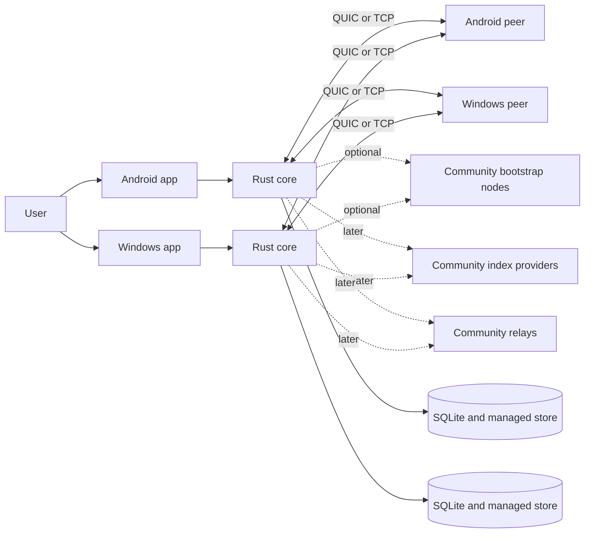

There is no Ember-operated account, file host, search database, or telemetry service. Bootstrap, index, and relay peers are optional infrastructure and never authorities for identity or ownership.

## 2. Container and module view

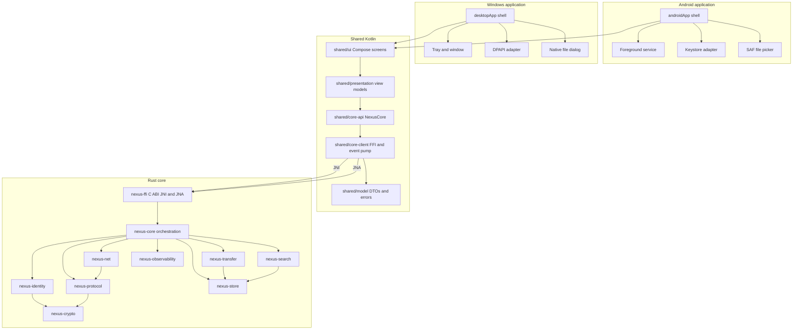

Kotlin never writes SQLite or the managed store. The platform shell supplies app-private paths and the sealed local secret; the core owns everything else.

## 3. Kotlin dependency direction

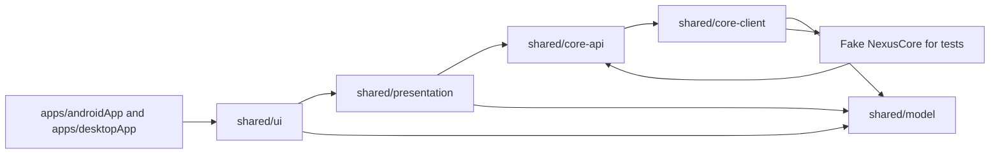

`shared/core-api` has no JNI, JNA, SQLite, libp2p, or Compose dependency. `shared/core-client` is the only Kotlin module that knows a native bridge exists.

## 4. Rust crate dependency graph

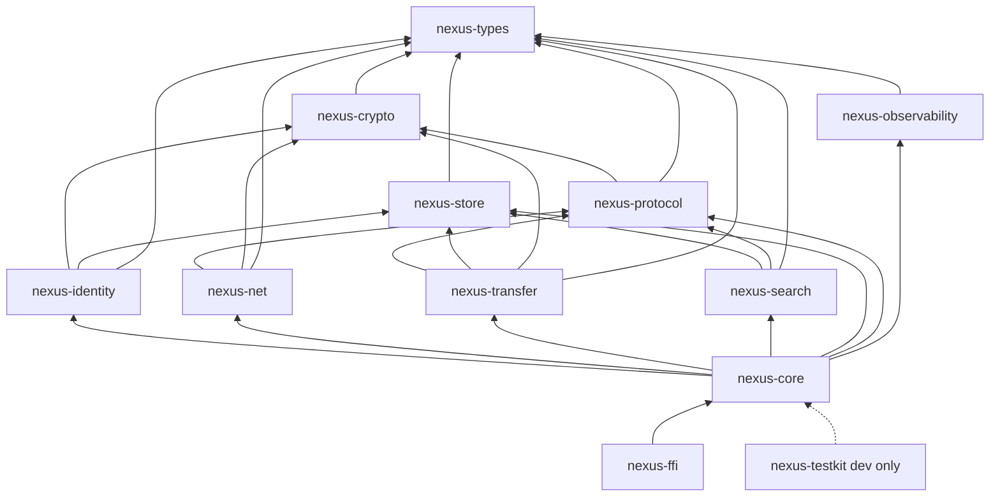

The graph is acyclic. A lower crate never depends on `nexus-core` or `nexus-ffi`.

## 5. Core runtime and threads

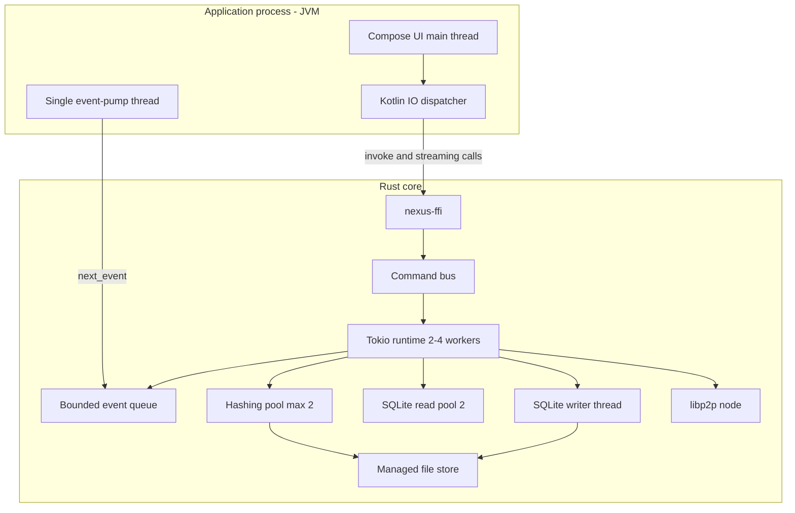

- No disk, network, or hashing work runs on the UI thread.
- The event pump is the only blocking native consumer.
- SQLite has one writer and a small read pool.
- Hashing is bounded to two concurrent jobs so several downloads cannot exhaust memory.

## 6. Identity creation and backup sequence

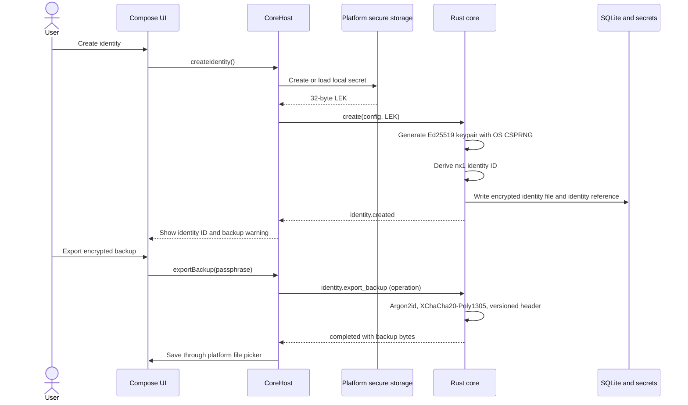

The private key never enters Kotlin. The platform secret seals the key at rest; the backup is the only portable copy.

## 7. Publish sequence

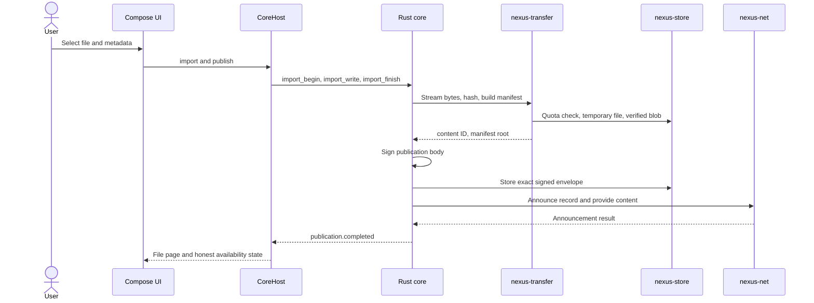

Publishing imports a managed copy. The external original is not modified or deleted.

## 8. Download and verification sequence

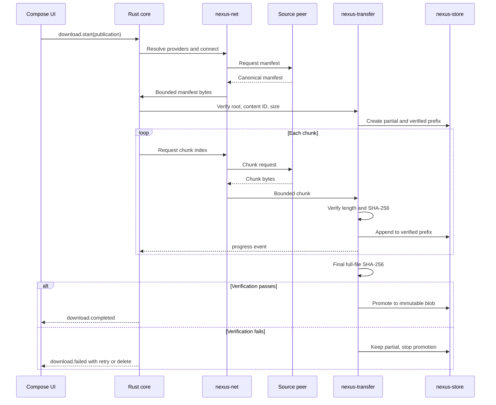

A failed source or chunk never becomes a completed file. The next source starts from the verified prefix.

## 9. Replica lifecycle

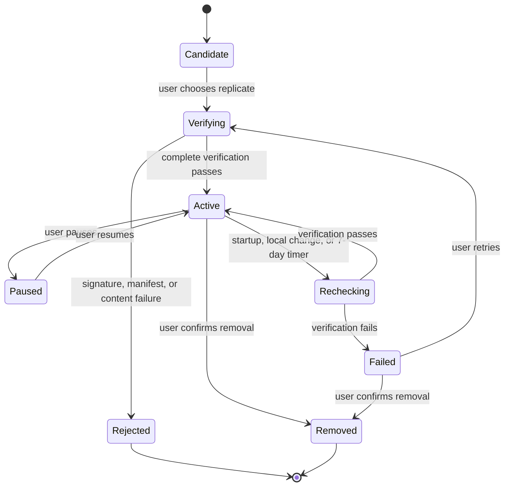

Only `Active` replicas are advertised. A failed re-verification immediately stops serving and advertising.

## 10. Storage entities

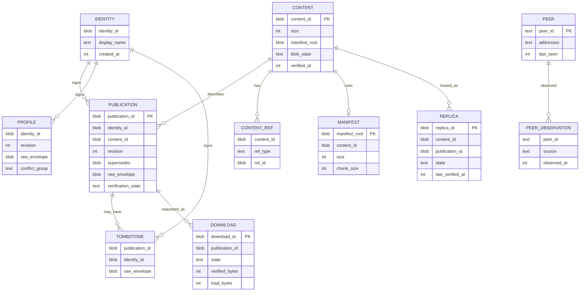

File bytes are not in this diagram. They live in the managed store and are referenced by content ID. Search tables are derived and omitted for clarity.

## 11. Trust boundaries

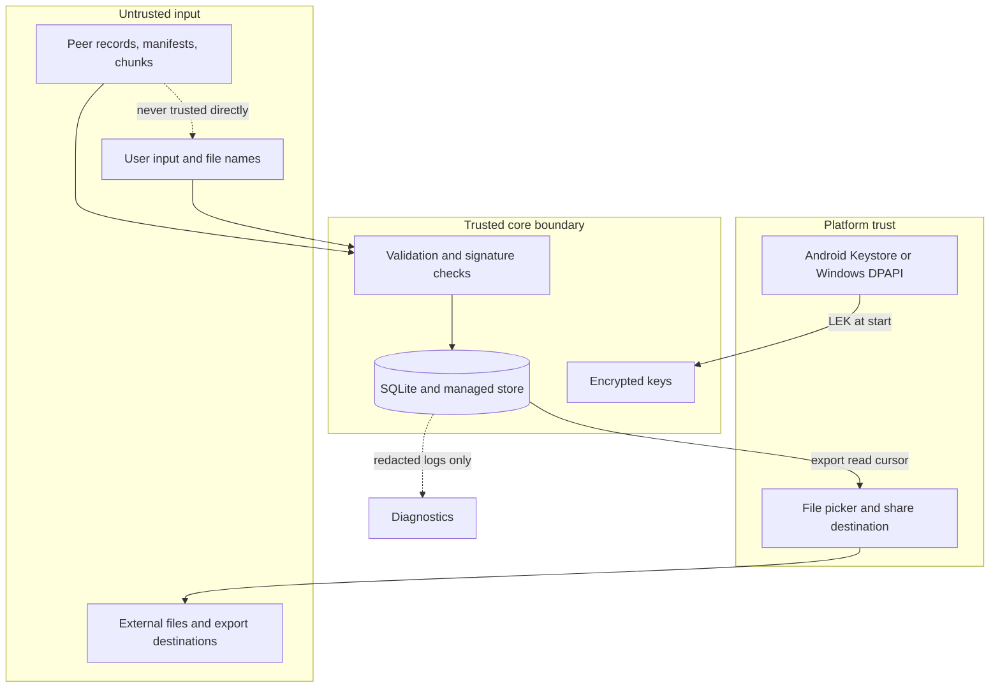

Validation happens before any record reaches SQLite, the search index, or the UI. The platform secure store is trusted only for sealing the LEK; the core still authenticates the identity file.

## 12. Core lifecycle

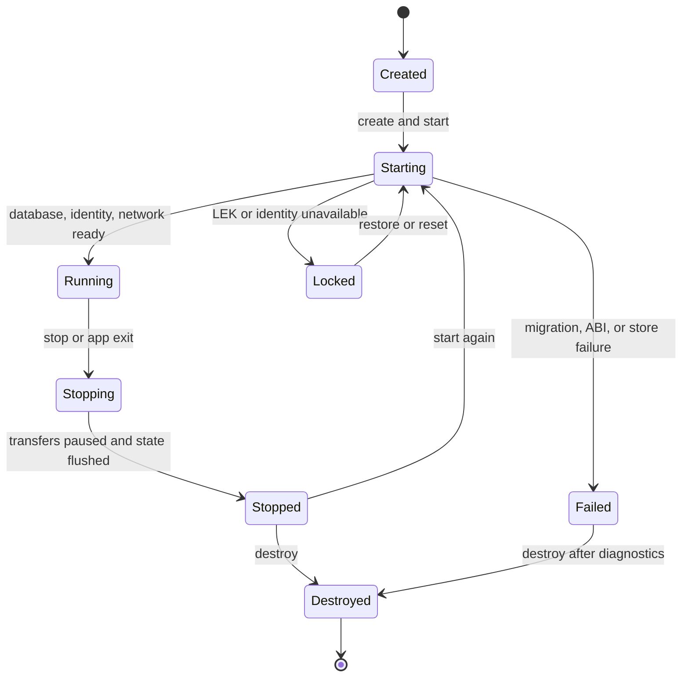

`Running` does not imply online. Network state is reported separately and can be `Online`, `Degraded`, or `Offline`.

## 13. Platform lifecycle view

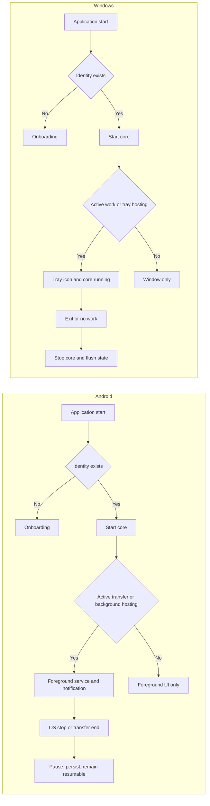

No platform starts a background node at boot or without a user action.
