# Ember User Flows

| Field | Value |
|---|---|
| Document ID | NEXUS-FLOWS-001 |
| Version | 1.0.0 |
| Status | Approved — Stage 01 |
| Date | 2026-11-12 |
| Normative source | [Product requirements](../PRODUCT_REQUIREMENTS.md), [Acceptance criteria](ACCEPTANCE_CRITERIA.md) |

This document defines the first-release user journeys, including alternate and failure paths. Each flow lists its goal, preconditions, main path, alternate paths, postconditions, and the acceptance criteria that prove it.

**Actors:** Publisher, Explorer, Downloader, Replicator. One person may act in all roles.

**Common rules:**

- Every screen must show network state honestly.
- A record existing does not mean content is available now.
- No destructive action happens without confirmation.
- No published file is exposed unless the user explicitly published or replicated it.
- No downloaded file is automatically opened or executed.

---

## J-01 First launch and onboarding

**Goal:** Understand public visibility, key responsibility, and availability limits before creating an identity.

**Preconditions:** Fresh installation with no local identity.

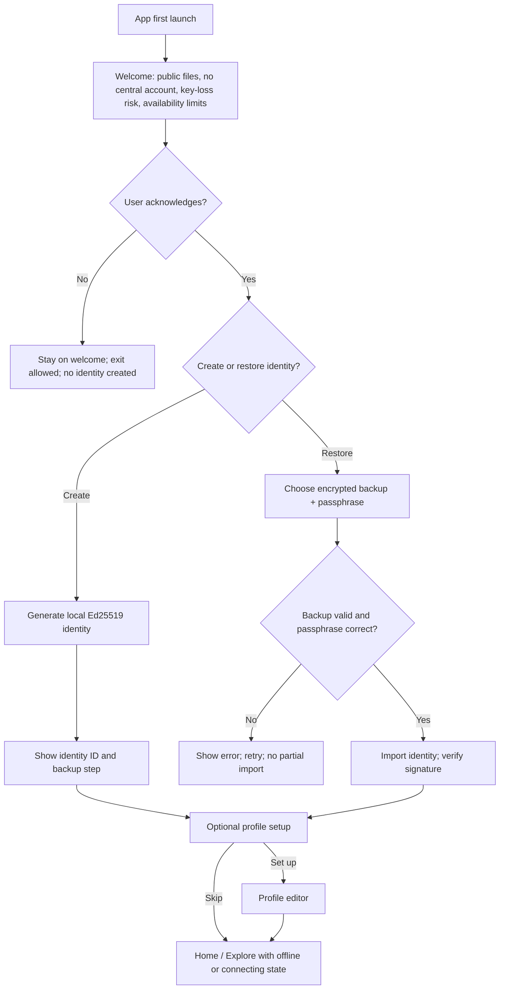

**Alternate and error paths:**

- User closes the app before acknowledgement: no identity, no data is created; onboarding restarts.
- User denies notifications: onboarding continues; transfer notifications are unavailable, and the app explains background limits.
- User has no network: identity creation and local profile editing still work; network screens show offline.
- Restore backup is corrupt, wrong version, or wrong passphrase: show a clear error, keep the welcome state, and never partially import.
- User cancels identity creation: return to welcome; no half-created identity remains.

**Postconditions:** A local identity exists and the user has seen the backup step, or the app remains in a clean welcome state.

**Acceptance:** ONB-001–ONB-004, ID-001, ID-004, UX-003.

---

## J-02 Identity creation, backup, and restore

**Goal:** Create a usable identity and leave with a backup the user understands.

**Preconditions:** Onboarding acknowledged; no active identity, or the user explicitly chooses to restore.

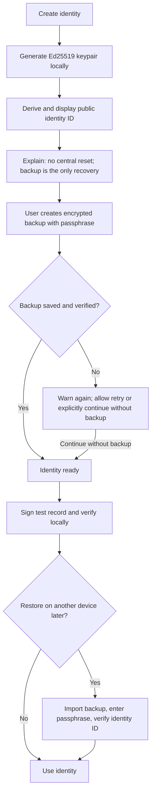

**Alternate and error paths:**

- Backup write fails (disk full/permission): show the failure, do not claim a backup exists, allow retry or explicit risk acceptance.
- Wrong passphrase: reject without revealing whether the file or passphrase was wrong; allow retry.
- Tampered backup: integrity check fails; refuse import.
- Restored identity ID differs from expected: refuse and explain.
- Same identity restored on a second device: both devices can sign; conflicting record versions are surfaced, not silently merged.
- Private key cannot be read at startup: identity unavailable; offer restore from backup; do not delete local records.

**Postconditions:** Identity can sign and verify; backup status is explicit; no plaintext key exists in logs.

**Acceptance:** ID-001–ID-008, PLAT-003.

---

## J-03 Profile setup and update

**Goal:** Publish a signed public profile and understand username collisions.

**Preconditions:** Local identity exists.

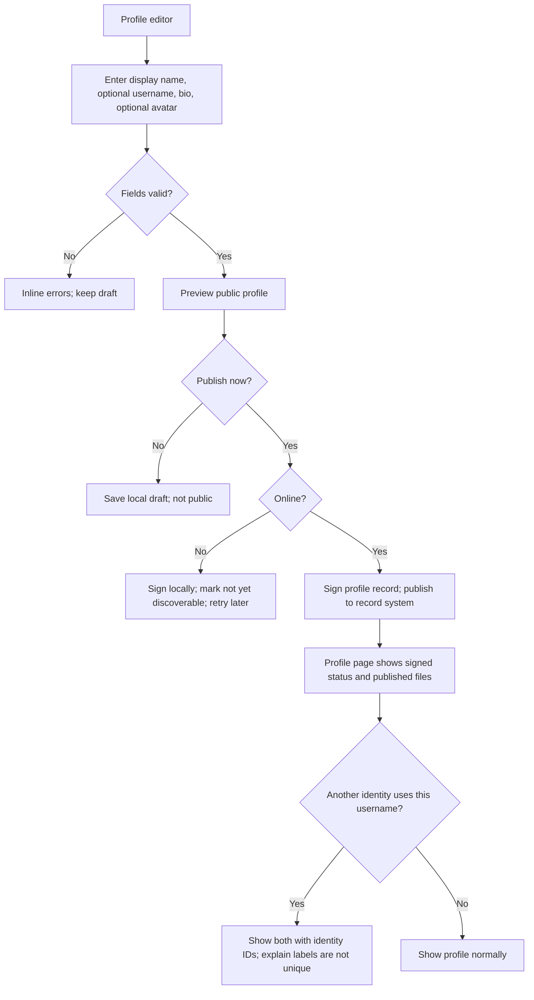

**Alternate and error paths:**

- Avatar too large or unsupported: reject with limits; keep the rest of the draft.
- Invalid signature after signing: do not publish; show an internal error and retry.
- Conflicting record version: show conflict; do not automatically replace.
- Offline: draft and signed record remain local; publish when online.
- User edits a published profile: create a new signed version; older version is superseded but may remain cached by peers.

**Postconditions:** A draft or signed profile exists; public status is accurate.

**Acceptance:** PROF-001–PROF-007.

---

## J-04 Publish a file

**Goal:** Publish a file publicly, sign its record, and serve it while online.

**Preconditions:** Identity exists; user has a file; sufficient quota/free space; file ≤4 GiB and ≥1 byte.

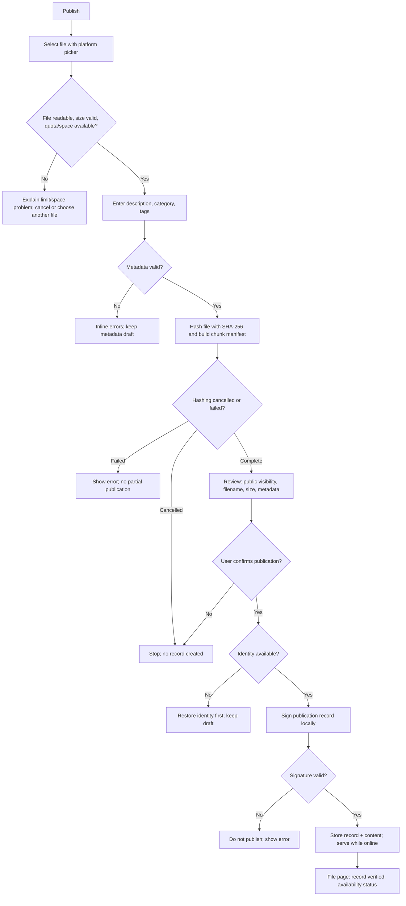

**Alternate and error paths:**

- Duplicate content by the same identity: offer a metadata update/new record version or cancel; do not create an ambiguous duplicate silently.
- Duplicate content by another identity: create a separate publication record; local bytes are deduplicated.
- File changes during hashing: detect and restart hashing; never sign a record for bytes that were not hashed.
- Disk full during copy/hash: stop safely; no signed record for incomplete content.
- Offline: sign and store locally; label "not yet discoverable"; advertise when online.
- User unpublishes immediately: sign tombstone; stop serving.

**Postconditions:** A signed record and a managed copy exist; the external original is untouched. The file is served only while the app is online and publishing is enabled, or the operation ends cleanly with no record.

**Acceptance:** PUB-001–PUB-008, HASH-001–HASH-005, DATA-005.

---

## J-05 Explore

**Goal:** Browse categories, recent records, and random records without a popularity feed.

**Preconditions:** App is usable; network may be offline.

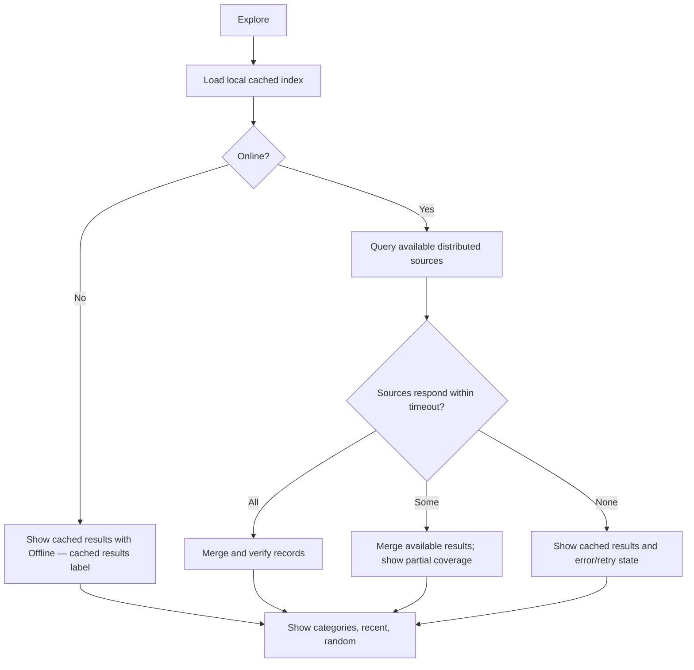

**Alternate and error paths:**

- No cached or discovered records: empty state explains that the network is small/offline and offers retry.
- Invalid signed records: excluded or quarantined; no crash.
- Duplicate publications: group by content but keep uploader attribution distinct.
- One index provider disappears: continue with remaining sources; label reduced coverage.
- Random discovery: select from discovered verified records; do not imply current availability, popularity, or completeness.

**Postconditions:** User sees honest, freshness-labelled discovery results or a clear empty state.

**Acceptance:** DISC-001–DISC-006, UX-003, UX-004.

---

## J-06 Search

**Goal:** Find profiles and files by username, filename, category, or tags, with honest partial results.

**Preconditions:** Search screen open; query ≤128 characters.

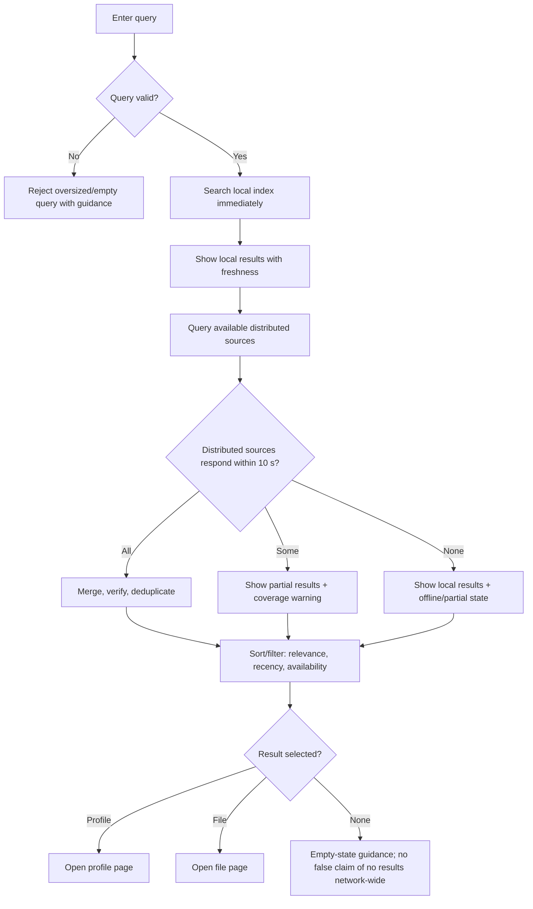

**Alternate and error paths:**

- Invalid signatures: exclude or mark unverified; never render untrusted HTML.
- Malicious/oversized metadata: sanitize, truncate display, and keep actions safe.
- Duplicate results across pages: deduplicate by record identity; stable pagination.
- Index provider disappears mid-query: show partial results and continue with remaining providers.
- No network: local/cached results only, clearly labelled.

**Postconditions:** Results are honest about coverage; no central search service was required.

**Acceptance:** SEARCH-001–SEARCH-006, DISC-002, DISC-003.

---

## J-07 Download

**Goal:** Download, verify, pause, resume, and safely complete a file.

**Preconditions:** A signed publication record is selected; at least one source is reachable; managed quota and free space are sufficient.

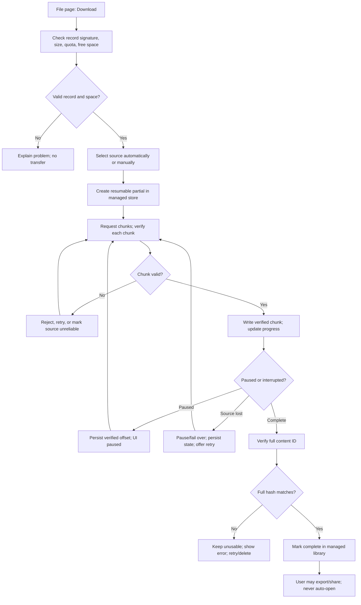

**Alternate and error paths:**

- No source online: file page remains; show "record only — no known source"; offer notify/retry? v1 offers retry, no notification promise.
- Disk full mid-transfer: stop safely; keep verified offset; do not corrupt existing files; explain how to free space.
- App killed/restarted: restore download state and verified offset; user resumes.
- Corrupt source: reject chunk, retry from another source if available, do not accept corrupt bytes.
- Unsafe filename: sanitize display/export name; storage path is generated and cannot escape.
- Final hash mismatch: do not mark complete; retain partial only if resumable; show retry/delete.
- User cancels: ask keep/delete partial; cleanup follows retention policy.
- Concurrent limit reached: queue with clear status, not silent failure.
- Tombstoned publication: allow download only while a source serves it; display warning.

**Postconditions:** A completed file is fully verified, or the partial state is honest and resumable/deletable.

**Acceptance:** DL-001–DL-014, HASH-002–HASH-005, DATA-005.

---

## J-08 Voluntary replication

**Goal:** Explicitly host a verified file and manage the hosted copy.

**Preconditions:** A signed publication record is selected; identity exists; sufficient quota and bandwidth settings.

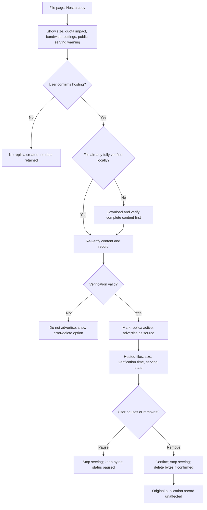

**Alternate and error paths:**

- Quota exceeded: block hosting with a clear explanation; do not silently evict other files.
- Corrupt local copy: re-download/repair or stop advertising.
- User removes replica: stop serving immediately, then delete after confirmation.
- Network offline: replica can be stored but not advertised until online; UI says so.
- Replica of tombstoned publication: show "unpublished by uploader" and do not imply uploader endorsement. The replica may continue as an independent source, or the user may stop hosting; the uploader cannot force removal.
- Never replicate automatically; downloading alone does not host.

**Postconditions:** A replica exists only by explicit choice and is served only after full verification; attribution is preserved.

**Acceptance:** REP-001–REP-008, PUB-011.

---

## J-09 Unpublish

**Goal:** Stop serving a publication and publish a tombstone without promising remote deletion.

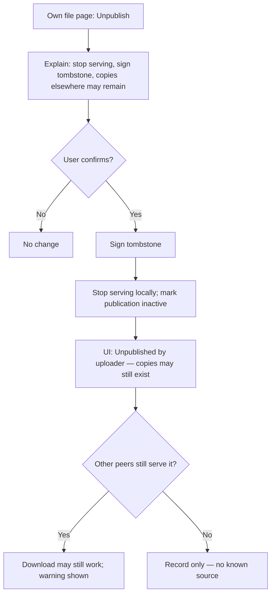

**Alternate and error paths:**

- No identity available: cannot sign tombstone; offer restore.
- Offline: sign locally and publish tombstone when online; stop serving immediately.
- User deletes local bytes: confirm separately; tombstone does not delete replicas held by others.
- Another identity's publication: user cannot unpublish it; only local block/report is later scope.

**Postconditions:** Local serving stops; a signed tombstone exists; no global deletion is claimed.

**Acceptance:** PUB-008, PUB-013, UX-007.

---

## J-10 Network status, bootstrap, and recovery

**Goal:** Understand connectivity, configure bootstrap paths, and recover from failures without a central service.

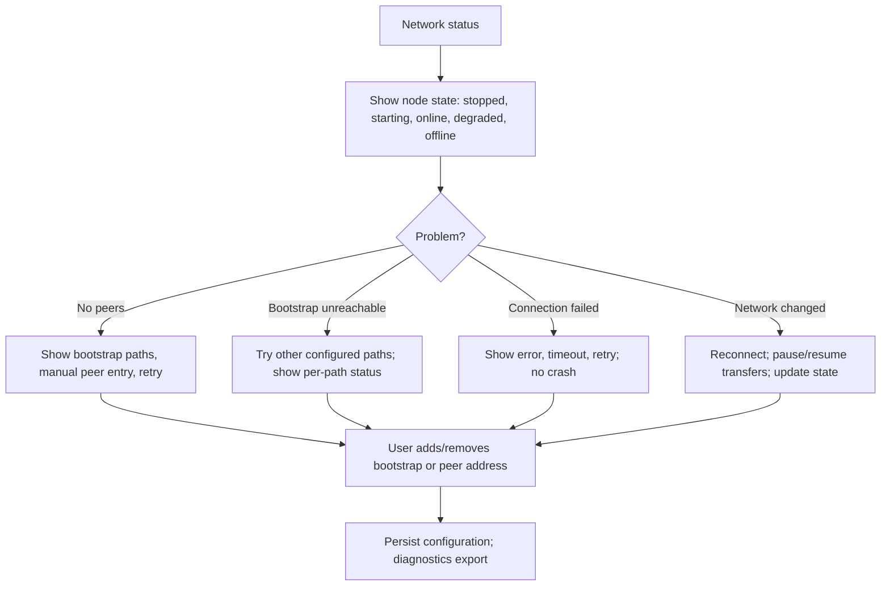

**Alternate and error paths:**

- All bootstrap paths fail: app stays offline/local-first; explain manual peer entry and community options.
- Invalid bootstrap address: reject with a specific error; keep existing list.
- One bootstrap disappears: use remaining paths; no automatic network-wide failure.
- Diagnostics export: redact keys, passphrases, local paths; user-initiated.
- Relay unavailable: later scope; v1 reports that direct connection failed.

**Postconditions:** User can see why the app is offline/online and has a path to recover; configuration persists.

**Acceptance:** NET-003–NET-006, BOOT-001–BOOT-004, UX-006.

---

## Cross-flow state model

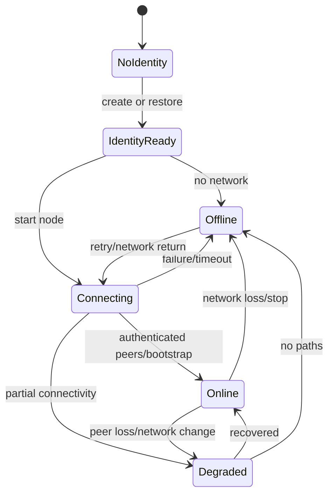

**Rule:** The global node state does not replace per-file availability. A node can be online while a specific file has no source, and a file can be available from a replica while the local node is degraded.
